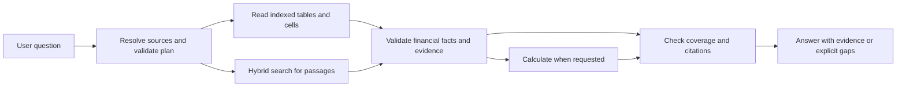

This is a rehearsal guide for presenting FinRAG Analyst to a VP in a short internship review. Prepared on 29 October 2026 from the local implementation and saved project reports. Suggested answers use first-person language: keep only statements that describe your own work, and describe shared work as a contribution.

The main message to communicate is: "I worked on making financial-document research easier to check: the application finds evidence, reads financial tables, performs calculations from validated inputs, and shows where its answers came from."

When the VP asks, "What project did you work on?", give this 40-second answer:

> During my internship, I worked on FinRAG Analyst, a financial-document research assistant. It helps a user ask questions about annual reports and earnings calls without manually searching each document. It can find reported figures, reproduce a requested source table, explain management commentary, and compare figures using a calculator. Answers include citations so the user can inspect the evidence. My focus was making the workflow more reliable around company and year selection, financial values, complete tables, and missing evidence. The current demonstration covers Microsoft and Tesla documents for 2024 and 2025.

This describes the business problem, deliverable, contribution and scope. The intended benefit is less manual document navigation and easier verification. A measured reduction in analyst research time has not been established by the saved RAGAS reports.

If the VP asks for the technical explanation, add:

> The application first identifies the company, source year and document type, then creates a structured plan. For a complete table, it tries direct lookup in the indexed filing. For individual numbers, it tries to bind the requested metric to the right table row and reporting-period column. For explanations, it combines semantic and keyword search. It loads surrounding passages, selects evidence that fits the context budget, validates extracted facts, and uses deterministic arithmetic for calculations. The final answer is checked against the request and its source references. Missing evidence is reported rather than filled in.



The diagram summarizes alternate paths. Every question does not execute every stage. A successful exact-table lookup can avoid embedding search and model extraction; mixed requests can use several paths.

If asked about the stack, say: "Python and FastAPI provide the application, a LangGraph workflow coordinates the steps, local Qdrant and BM25 provide retrieval, and the current model profile uses GPT-4o mini. Pydantic schemas and deterministic validation constrain intermediate results. The browser displays the answer, evidence and permitted traces." Local settings enable extractive compression and disable optional Cohere reranking. Documents and indexes are local, while configured model and embedding requests use external APIs.

For a five-minute meeting, use this schedule. It is a speaking plan, not a latency guarantee.

| Time | What to do |
|---|---|
| 0:00-0:40 | Explain the problem, project and your contribution. |
| 0:40-1:40 | Show a complete source table and open one citation. |
| 1:40-2:40 | Show a comparison and its calculation. |
| 2:40-3:30 | Show a narrative answer if time permits; otherwise keep its saved example ready. |
| 3:30-4:15 | Explain one challenge and the improvement you made. |
| 4:15-5:00 | Explain the next three months and take a question. |

If you have only two minutes, use the 40-second introduction, one comparison with a citation, and a short next-step statement. Do not attempt every demonstration below in a short meeting.

Before demonstrating, start the app from a PowerShell terminal in this workspace:

```powershell
Set-Location 'C:\Users\tfd603\Downloads\FinRAG_Phase1_Corrected\finrag'
.\.venv\Scripts\python.exe -m uvicorn backend.main:app --host 127.0.0.1 --port 8000
```

Open `http://127.0.0.1:8000`. Check `http://127.0.0.1:8000/api/health` and `http://127.0.0.1:8000/api/catalogue`. The local HTTP checks during preparation could not connect; this guide does not establish that the server is currently running.

The active environment setting is `phase1-v2-repair-20261024`. The API configuration also lists `phase1-v2`; the service manager automatically adds the active index first. Confirm the selected index in the running application. The repaired index manifest records eight sources, 375 parents and 1,491 children. The original v2 index has different chunk counts. Do not mix index-specific performance claims.

For independent demo questions, start a new chat or clear history and clear company/year/document filters. A Microsoft-only filter can conflict with a two-company comparison. For the clarification example, both history and filters must be empty. Rehearse the exact prompts against the intended index before the meeting. Repeated requests may use a cache if enabled; describe saved or cached output accurately. Keep original documents and saved results available, but label saved examples as saved examples.

The prompts below are supported by saved examples or the existing gold set. They were not freshly executed against the model during preparation of this guide. Expected figures are checks for rehearsal, not a promise about a future response.

For the first core demonstration, ask:

> Show the complete balance sheet presented in Microsoft's 2024 annual 10-K, preserving every row and reported year column.

Show the table title, the units, the 2024 and 2023 columns, and one citation. The saved API example reports total assets of 512,163 million USD for 2024 and 411,976 million USD for 2023. Its local replay recorded 42 rendered rows; this count describes the indexed rendition, including its layout.

Say while showing it:

> This is a request to reproduce a source table. The application identifies the table in the indexed filing and renders its stored rows and columns. Notice that a 2024 filing also contains a 2023 comparison column. The table's source and its reported periods stay separate. The citation opens the stored evidence so the result can be checked.

The workflow is: resolve MSFT / 2024 / 10-K; plan a complete-table requirement; call `get_financial_statement`; match an indexed HTML table by caption and headers; expand row/column spans; check completeness and requested periods; render the table through finalization. A successful direct lookup does not require hybrid search or LLM table rewriting. Completeness is relative to the selected indexed table, not an independent audit of the original PDF or continuation pages.

For the second core demonstration, ask:

> Compare Microsoft and Tesla total revenue for fiscal 2025 according to their 2025 10-K filings. State both values and the difference.

Expected saved figures are:

| Measure | Value |
|---|---:|
| Microsoft FY2025 revenue | 281,724 million USD |
| Tesla FY2025 revenue | 94,827 million USD |
| Microsoft less Tesla | 186,897 million USD |

Show both source references and the displayed calculation, `281724 - 94827`. Microsoft and Tesla have different fiscal year ends; this compares their respective FY2025 annual totals, not identical reporting calendars.

Say:

> Here the system needs evidence from both companies. It validates the two revenue figures and their units before subtracting them. The difference comes from the calculator, and both inputs remain traceable to their filings. The displayed comparison table is assembled from validated facts; it is different from reproducing an existing source table.

The workflow is: create two fact requirements and a difference calculation; search each permitted company/year group; attempt direct table-cell recovery, falling back to hybrid retrieval and extraction as needed; validate both facts; perform subtraction using their fact IDs; check that both sides and the requested calculation are covered; render citations. Do not say hybrid search always ran: inspect the trace if the VP wants the actual path for this request.

For a third demonstration of narrative retrieval, ask:

> According to Microsoft's 2024 10-K, why did Microsoft increase the estimated useful lives of server and network equipment from four years to six years?

The saved answer cites software investments that improved operating efficiency and advances in technology. Show the supporting quotation, document and section. The saved sources include Item 8 and Item 7 passages; the fresh source selection can differ.

Say:

> This question asks for an explanation rather than a table cell. Semantic search helps find related wording, while BM25 preserves exact terms. The system restores surrounding context and selects supporting source observations. I can open the citation and check that the explanation is actually in the filing.

The workflow is: plan a narrative requirement; search MSFT / 2024 / 10-K; combine dense and BM25 rankings with reciprocal-rank fusion; load parents; apply extractive compression where appropriate; select source sentences; audit support and requested coverage; render the supported explanation with citations. Optional Cohere reranking is disabled in the inspected local settings.

Keep these additional prompts as backups or answers to follow-up requests:

| Purpose | Exact prompt | Expected saved result or behavior |
|---|---|---|
| Quick numeric demonstration | According to Microsoft's 2025 10-K, what were total assets as of June 30, 2025? | 619,003 million USD, with a source citation. |
| Source year versus value year | According to Tesla's 2024 10-K, what was net cash provided by operating activities for the comparative year 2023? | 13,256 million USD, identified as a 2023 value from the 2024 filing. |
| Transcript evidence | According to Microsoft's fiscal Q4 2024 earnings call, what were capital expenditures including finance leases, and how much cash was paid for property and equipment? | 19 billion USD and 13.9 billion USD; do not treat these as interchangeable measures. |
| Cross-transcript calculation | Compare Microsoft's fiscal 2024 earnings-call transcript with its fiscal 2025 earnings-call transcript for commercial remaining performance obligation. State both values and the dollar increase. | 269 billion USD, 368 billion USD and a 99 billion USD increase. |
| Missing scope | What was revenue? | With clean history and filters, request the missing scope rather than guessing. |
| Unsupported source year | According to Microsoft's 2030 10-K, what was total revenue? | Report unavailable source coverage; do not produce a figure from another year. |

When asked, "What did you improve?", use three concrete examples that match your actual contribution:

> I worked on retrieval quality, financial correctness checks and the reliability of the complete workflow. Hybrid retrieval combines meaning-based search with exact terms, and comparison searches preserve evidence from each requested group. For financial values, the system checks the metric, reporting period and units against the source before using the value. I also worked on preserving complete source tables and ensuring that retrieved evidence reaches final validation. I evaluated failures through saved traces and regression cases rather than judging only whether an answer sounded convincing.

For a shorter, more specific answer:

> One improvement was separating a request to display information in a table from a request to reproduce an exact source table. Another was keeping the filing year separate from the year of a value inside the filing. Both changes address concrete ways a plausible answer can be wrong.

Use the actual repository reports when asked for measurements:

| Evidence | What can accurately be said |
|---|---|
| Saved 28 October offline release report | It records 736 tests and 70 subtests with no failures or errors. This is a saved software-regression result, not proof of answer accuracy or a fresh test run for this guide. |
| Latest merged 90-question report | 73/90 marked answered; mean RAGAS score 0.8365 over answered rows with available metrics; 70 fully scored answered rows. |
| Coverage-adjusted score | 0.6785 in that merged report. |
| Prior September 90-question report | RAGAS 0.8186 and 87/90 marked answered; different answer coverage means a higher latest average does not establish better overall quality. |
| Report provenance | The latest report merges 61 original rows with 29 replacements from a rerun. It is not a fresh current-code full-suite acceptance run. |
| Business impact | Analyst time saved and production ROI still need a measured user study. |

An honest spoken quality answer is:

> I measure software behavior and answer quality separately. The latest saved offline report records 736 tests and 70 subtests passing. The latest combined evaluation marks 73 of 90 questions answered and has a 0.8365 RAGAS mean over scored answered rows. That is not 83.65 percent accuracy, and the report combines an original run with reruns. Known answer and coverage failures remain, so I would describe this as a prototype being prepared for a controlled pilot.

When asked, "Which skills did you improve?", connect each skill to work rather than listing tool names:

| Skill | An example you can discuss if it was your work |
|---|---|
| Python and backend development | Connecting a validated request to retrieval, tools and a FastAPI response. |
| RAG system design | Combining dense and BM25 retrieval, selecting parent context and managing evidence budgets. |
| Data modeling and validation | Defining structured plans and distinguishing reported facts, source tables and derived calculations. |
| Debugging | Tracing a wrong answer to planning, retrieval, extraction or finalization, then reproducing the failure. |
| Testing and evaluation | Building regression cases and interpreting RAGAS alongside answer coverage and manual evidence review. |
| Financial-document understanding | Handling comparative periods, units, per-share values, qualifiers and different fiscal year ends. |
| Communication | Explaining what a result proves, its limitations and the next experiment needed. |

Suggested answer:

> My biggest learning was how to build and debug a complete AI application rather than just a prompt. I became more comfortable with Python APIs, retrieval, structured outputs and testing. I learned to separate a failure in planning from a failure in retrieval or validation. I also became better at interpreting financial evidence and explaining results without overstating what a metric proves.

The repository also contains a separate QLoRA dataset, training, serving-benchmark and MLflow tracking workflow. If you personally worked on it, mention that contribution separately: "I also worked on preparing and evaluating a task-specific model adaptation." The application's inspected default model is GPT-4o mini. Do not describe the Qwen LoRA adapter as the active application backend or present its isolated generation benchmark as full-agent acceptance; the inference guide explicitly keeps that switch in staging pending end-to-end validation.

When asked, "What technical challenges did you face?", choose two stories and explain the symptom, cause, change and evidence:

| Challenge | What made it difficult | Work performed in the project | What to say about the result |
|---|---|---|---|
| Wrong reporting period | A 2024 filing can contain a requested 2023 value. | Separate source year from reported period and bind values to table columns. | The saved Tesla comparative-period example returns the 2023 value from the 2024 filing. |
| Retrieved table became a summary or no answer | Retrieval succeeded, but planning classified a table as narrative or routing stopped before finalization. | Preserve full-table intent, render indexed rows and route returned statements through finalization. | Saved balance-sheet and operations-table replays demonstrated the corrected paths at those snapshots. |
| Wrong numerical identity or unit | A number can appear in the source while belonging to a different metric, year or unit. | Validate row, column, period, quantity type and units; use validated operands for arithmetic. | These checks reject specific invalid bindings; known errors in later evaluation show they are not an absolute guarantee. |
| Different wording and incomplete comparisons | Exact keywords miss paraphrases; semantic search can miss precise labels or one side of a comparison. | Combine dense and BM25 retrieval and balance source groups. | Discuss how the design addresses the failure and evaluate both returned coverage and correctness. |
| High token usage and slow recovery | Repeated large passages and open-ended retries increase work. | Use parent deduplication, extractive compression, bounded recovery and usage traces. | Measure latency and cost on a fixed workload; avoid claiming an unmeasured universal speedup. |

A natural 45-second challenge answer is:

> One challenge was that successful retrieval did not always produce a correct final answer. For example, an exact table could be retrieved but summarized because the request was classified incorrectly. I followed the request through planning, lookup and finalization, preserved the table requirement, and added regression coverage. Another challenge was financial period binding: the year of a filing is not necessarily the year of every value in it. That taught me to validate the source and table cell independently instead of treating a retrieved number as automatically correct.

If your personal role was verification rather than implementation, change "I preserved" to "I reproduced and verified the correction" and identify what you tested.

When asked, "What happens if lookup fails?", say:

> A normal lookup miss can fall back to hybrid search, and missing requirements can receive a focused recovery within the budget. Values still have to pass source validation. A retrieved passage does not automatically establish a complete source table. If evidence or verification remains insufficient, the application returns supported parts with explicit gaps or a validation error. Provider outages are reported separately from missing evidence.

One current technical limitation is useful to know for deeper questions: `statement_id` is created through a successful direct table lookup. Hybrid fallback evidence is not automatically promoted into a verified complete-table result. A related table can therefore be retrieved while the complete-table requirement remains unavailable. This is a reasonable reliability task for the extension, with completeness checks preserved.

When asked, "What would you do with three more months?", propose a bounded, measurable pilot plan:

| Period | Focus | Concrete deliverable | How to assess it |
|---|---|---|---|
| Month 1 | Reliability and a reproducible baseline | Reproduce remaining planning, metric, period and evidence-coverage failures; improve shared contracts; run a fresh frozen evaluation and an independently reviewed held-out set. Record code, dataset and index versions. | Report complete and reviewed-correct answers across the entire set, unsupported claims, abstentions and failure categories, alongside RAGAS. |
| Month 2 | Cost, latency and task usefulness | Profile the slowest stages; reduce redundant context/calls without weakening checks; add a small agreed set of documents or user tasks; validate ingestion and source coverage. | Compare response latency, complete per-request application cost and reviewed quality under the same workload and cache conditions. Measure analyst task time against manual research. |
| Month 3 | A controlled internal pilot | Work with engineering/security mentors on access controls, approved data handling, shared storage/concurrency, monitoring and feedback; run a small user pilot. Evaluate the local-model option only if it meets tool/schema requirements and there is a business reason. | Review user success, correction rate, source verification, operating cost and agreed readiness criteria; produce a deployment recommendation. |

Suggested spoken answer:

> I would use the extension to turn the prototype into a measurable internal pilot. In the first month, I would address the remaining reliability failures and establish a fresh, reproducible quality baseline. In the second, I would improve latency and cost while testing real analyst tasks and a small expansion of the corpus. In the third, I would work with the team on access controls, monitoring and a controlled user pilot. I would measure success through reviewed answer quality, task time and operating cost, with targets agreed after establishing the baseline.

Three additional VP questions to prepare for are:

"Who would use this, and how would you prove its value?"

> The initial users would be people researching filings and earnings calls, such as financial research or business-analysis teams. I would choose representative tasks and compare manual research with assisted research. We would measure completion time, correctness and how easily a reviewer can verify the evidence. I would not claim ROI until that comparison is measured.

"Why build this instead of using a general chatbot with uploaded PDFs?"

> The project provides an explicit workflow for selecting company and source periods, reading complete tables, validating numbers and calculations, and tracing answers to an approved versioned corpus. That gives us controls and failure diagnostics we can test repeatedly. Whether it delivers enough additional value should be demonstrated on our users' actual tasks rather than assumed.

"Is it ready for deployment, and can we use confidential documents?"

> I would propose a controlled pilot first. The current model and embedding configuration sends selected content to external APIs, so confidential use requires an approved data-handling design. We also need the right access controls, operating environment, quality checks and monitoring. There is a separate local-model experiment, but its full tool workflow still needs validation before it can support a local-processing claim.

If the demo fails, acknowledge the visible outcome and explain the next diagnostic step:

> This request did not complete verification. I would check whether the failure came from source coverage, planning, extraction or the provider. The application has recorded diagnostics for that distinction. I have a saved example of this workflow that I can show, clearly labeled as a previous run.

If the question is outside scope, say: "The selected index does not contain that source. The next step would be to ingest and validate it, rather than answer from another year." If you do not know an answer, say: "I have not measured that yet. I would check [specific evidence or experiment] before giving a number."

Finish the discussion with a concrete next step if asked what support you need: "A small group of pilot users, an agreed set of research tasks and acceptance criteria, and engineering guidance on the approved deployment environment would let me measure whether this is useful beyond the demonstration."

Evidence used to prepare this guide is available locally:

- [Lookup implementation](finrag/src/retrieval/structured_lookup.py)
- [Tool selection, lookup fallback and finalization](finrag/src/agent/tools.py)
- [Fact extraction and validation pipeline](finrag/src/financial/fact_pipeline.py)
- [Graph routing](finrag/src/agent/graph.py)
- [Saved 10-question API examples](finrag/evals/results/financial_facts_tables_api_final_20261013_answers.md)
- [Latest merged evaluation review](finrag/evals/results/production_90_combined.md)
- [Latest merged evaluation details](finrag/evals/results/production_90_combined.json)
- [Saved 28 October offline release summary](finrag/evals/results/release_contracts_20261028.summary.json)
- [Repaired index manifest](finrag/Data/indexes/phase1-v2-repair-20261024/manifest.json)
- [Local-model staging limitations](finrag/fine_tuning/inference/README.md)

The older PROJECT_WALKTHROUGH.md is useful background, but its September test counts, default-index details and evaluation summary are historical. Use dated reports for meeting claims. No application code, runtime configuration, index or original evaluation report was changed to prepare this guide, and no fresh model, embedding or judging calls were made.
