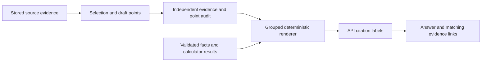

# Answer presentation and citation repair

## Current financial-fact and table verification (2026-10-13)

The remaining financial-fact/table repair is complete. Latest offline verification: **459 tests and 66 subtests passed**. After the approved local server restart, the final ten-question API run answered **10/10**, with one table per exact-table request, source-bound per-share units, and short source-linked citations. All 473 selected source cells were retained in the six table answers. The final run used 153,750 LLM tokens, an estimated $0.02008425 LLM cost and 10.16 seconds mean HTTP latency. See [FINANCIAL_FACTS_TABLES_REPAIR.md](FINANCIAL_FACTS_TABLES_REPAIR.md) for causes, changes, results, historical comparisons and indexed-source limits. Earlier verification sections below describe earlier code snapshots, not the latest result.

## Problem

The final renderer joined source quotations into one long bullet per requirement. Source Markdown styling, headings and fragments could leak into the answer. Stable internal source IDs were also used directly as visible citation labels. Numeric formatting exposed implementation labels such as "245122 millions USD".

## Shared replacements

| Before | After |
|---|---|
| One paragraph containing many quoted sentences | Company/period headings and short thematic points |
| Copied source styling and fragments | Plain-text draft statements, independently checked against their referenced evidence, then escaped for Markdown |
| Long hashed source citation IDs | Response-local S1, S2, ... labels; original identity retained in `internal_id` |
| `245122 millions USD` | `245,122 million USD`, with value and precision preserved |
| Separate numeric bullets for multiple companies or periods | A comparison table with company, reported period, metric, value, source document and citations |
| Calculation result without its working | Result, operand order, approved calculator formula and calculator substitution |
| Only a retrieved-source count | Separate cited and retrieved counts |
| Literal nested underscores or a fenced Markdown answer | Safe rendering of nested bold/italic text, headings, lists and tables; answer-wide Markdown fences are unwrapped |
| History saves only the first twelve sources | Every cited source is retained, including those beyond the normal history limit |



Draft points reuse the existing evidence-selection call. Independent point support is checked in the existing verification call. No additional model call, provider, retrieval pass or dependency was introduced for presentation.

Every point references quotes from its own requirement. Rejected or missing quote references cannot be displayed as supported points. Numeric claims are checked against supporting evidence; source-reported or validated period context supplies dates. Source wording is not permission to invent new calculations or financial values. Numeric facts and calculator results remain rendered from validated data.

Company, source document and reported period remain separate. Related requirements share headings; calculations and interpretation have their own sections. Structured statement tables retain their existing renderer and completeness status.

Comparison layout is selected from the validated facts' company/period pairs, not question wording. Equal values in different periods remain separate rows. Calculation details come directly from the deterministic calculator's trace, without another model call or formula evaluation. Narrative headings and verified supporting points remain grouped by company and period for mixed questions.

The browser renders all six heading levels and handles nested bold/italic formatting without inserting source HTML. HTML and static assets use cache revalidation. New API answers include an `answer_format` marker; earlier-format messages show a reload reminder. Historical answer text is preserved rather than silently rewritten into a new factual answer.

Citation numbering happens after the financial/evidence checks. Cited sources appear first, remaining retrieved sources follow, and replacement occurs in one pass to avoid ID collisions. Graph state, fact/calculator IDs and trace identities retain their original IDs. The HTTP and streaming endpoints use the same response formatter. Historical UI messages receive short display labels while preserving their original click targets.

There are no runtime branches for risk factors, Microsoft, Tesla, fixed years, gold IDs or individual questions. The rules apply to the shared answer schema and presentation boundary.

## Verification

- Earlier full offline suite: **444 tests and 64 subtests passed** (2026-10-13), including generic named-table planning, routing and layout regressions. The current full result is recorded above.
- Earlier focused presentation/evidence/API suite: **226 tests and 22 subtests passed**; these tests are included in the latest full run.
- Frontend JavaScript parsed locally in V8. Runtime checks passed for nested styling, escaped literal text, headings, lists, comparison tables, Markdown wrapper removal, genuine code blocks, short citation labels with original evidence click targets, and cited-source history retention.
- HTTP and streaming tests verified short IDs, source matching and retained internal identity.
- Tests cover numeric precision, same-label collisions, rejected point support, rejected quote references, invented numeric claims, point-index remapping, grouped companies, unchanged selection/verification call counts, equal-value comparison rows, source-year/reported-period separation, calculator formulas, response format markers and asset cache headers.
- Existing dependency deprecation warnings remain.

No live model/corpus evaluation was run for the risk-factor question. These checks establish the presentation and evidence-link contracts, not complete retrieval of every risk category or a measured latency reduction. A source-grounded summary must not be presented as an exhaustive filing inventory without establishing coverage.

## Load the changes

Stop the current FastAPI process with Ctrl+C, restart it, hard-refresh the browser (Ctrl+F5), and ask a new question. Previously stored answer text is not regenerated automatically. The server command from the `finrag` project directory is:

```powershell
.\.venv\Scripts\python.exe -m uvicorn backend.main:app --host 127.0.0.1 --port 8000
```

The model may emit a few additional draft-point tokens. The model call count is unchanged; actual token usage and latency need a live before/after comparison.

## Retrieved table rejected before finalization

The latest failed request was: "give me the exact balance sheet presented inside the msft 2024 10k report". Its trace showed successful indexed retrieval, 42 rendered rows, 2024/2023 columns, and `truncated=false`. There was no `finalize_financial_answer` call. The service correctly rejected the model's unverified response with `missing_validated_answer`.

The existing graph router now requires tool calls while a validated research plan is active. A plain model response cannot replace finalization. Verified results, exhausted validation, and clarification requests can terminate normally. Non-JSON schema-error messages remain diagnostics rather than being parsed as terminal results. This uses the existing router and finalizer; there is no balance-sheet, company or question-specific runtime branch.

Offline regressions cover all three statement types, source-year/reported-year separation, normal graph termination after one successful finalization, clarification without retrieval, and rejected numeric/schema selections. A local replay using the actual `phase1-v2` indexed balance sheet and the saved validated request plan successfully rendered and validated all 42 output rows, with short citations. Its output is `evals/results/msft_2024_balance_sheet_local_replay.md`. This replay made no model, embedding or reranking API calls; it does not replace a fresh end-to-end model run.

The routing fix does not invent missing table rows or remove completeness/source validation. Tables missing from the index, ambiguous tables and partial evidence must still be reported honestly.

## Exact statement request incorrectly summarized

The next request named Tesla's `CONSOLIDATED STATEMENT OF OPERATIONS` table. The plan incorrectly classified it as `narrative`; the table was retrieved, but selection and verification followed that narrative classification and accepted a short summary. Finalization was called, so this was a planning/format-contract failure distinct from the earlier missing-finalization issue.

The planner now preserves explicit full-table intent for recognized statement requirements, using the existing query parser and structured lookup's canonical statement terms. The plan validator and tool-input normalization reuse that same term matching. In particular, statements of operations match the income-statement tool while the original filing title remains the display label. No new company, year, gold-question or query-specific branch was introduced. Mixed narrative requirements stay narrative; requests for individual values or summaries do not automatically become full-table requests.

A local replay of the actual saved incorrect plan, through the corrected planning path and `phase1-v2` indexed evidence, returned a verified table with **39 rows and 2025/2024/2023 columns**, with `truncated=false`. The result is `evals/results/tsla_2025_operations_table_local_replay.md`. This reused a mocked planner response and made no paid API calls. Tests also cover singular/plural statement titles, all three supported statement types, mixed table/narrative requests, and individual-value/summary intent.

## Generic named-table support

The active tool schema and plan validator previously restricted complete-table requirements to three primary financial statement types, although the existing indexed lookup could match arbitrary table captions. That interface restriction has been removed. The same `get_financial_statement` tool now accepts a specific named table subject in `statement_type`, and `kind=statement` represents a requested structured source table, including notes, schedules and nonfinancial tables. Existing primary-statement identifiers remain compatible.

Fixed statement search templates were removed. Lookup/search uses the planned table subject; arbitrary names and qualifying words are retained instead of being reduced to a primary-statement category. Explicit exact/full table intent is carried into the planner input and retained in each requirement's evidence question. The existing query parser and named-caption/header matcher guide the shared table path. Computed comparisons still use validated facts/calculations, and descriptive requests remain narrative.

The renderer reads the indexed table, preserves all returned rows/columns, and checks source scope, requested periods, qualifiers and completeness. It handles text-only tables, tables without year headers, and wide source tables. Ambiguous, missing or over-budget evidence does not become a fabricated complete table. No new private helper, per-question branch, company condition or formula evaluation was added.

The full offline run passed **444 tests and 64 subtests**. Generic graph tests cover debt maturities, geographic revenue, leases, comprehensive income, equity changes, supplemental balance-sheet information and operational schedules, alongside primary-statement compatibility. Text-only tables with two and twelve columns are checked through graph finalization. Existing tests retain ambiguity/source/year rejection contracts. Additional local lookup previews returned non-primary indexed tables from MSFT and TSLA 2025 sources without API calls; these lookup previews do not constitute a fresh end-to-end model evaluation.
