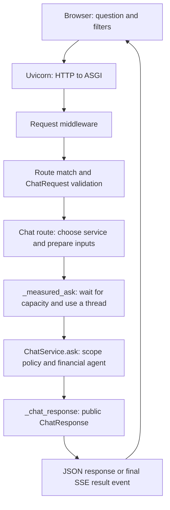

**Learn FastAPI through your FinRAG project**

This guide follows the implementation in this checkout. Read one numbered topic,
predict its behavior, and verify your prediction in the code or the lab. Aim to
explain why each step exists before trying to remember its syntax.

The companion [fastapi_learning_lab.py](fastapi_learning_lab.py) runs the real
FastAPI routes with a teaching service. It needs the project's installed Python
environment, but does not open financial indexes or call model providers.

**1. First establish what each part does.**

Suppose the user asks: "Explain Microsoft's 2024 10-K revenue."

The browser collects that question and the selected filters. FastAPI receives an
HTTP request, validates its public contract, chooses a service, and arranges for
that service to run. `ChatService` interprets the financial question and invokes
the agent when the scope permits research. The API turns the internal result into
the public response, and JavaScript displays it.



The diagram follows a valid chat request. Invalid input can return earlier. A
streaming request also sends progress events while the service work is pending.

| Component | Responsibility in this project | Start reading here |
|---|---|---|
| Browser JavaScript | Builds requests, reads events, saves conversation state | [frontend/app.js](frontend/app.js), `requestPayload`, `streamChat` |
| Uvicorn | Listens for HTTP connections and runs the ASGI application | Server command below |
| FastAPI and Starlette | Routing, request handling, middleware, response transport | [backend/main.py](backend/main.py), `create_app` |
| Pydantic | Validates and normalizes declared API data | [backend/models.py](backend/models.py), `ChatRequest` |
| ServiceManager | Owns reusable services for allowed indexes | [backend/service_manager.py](backend/service_manager.py) |
| ChatService | Scope resolution and financial agent orchestration | [src/app/chat_service.py](src/app/chat_service.py), `ask` |
| Agent and retrieval modules | Financial planning, evidence retrieval, calculations, answer verification | [src/agent/graph.py](src/agent/graph.py), `create_finrag_agent` |

The Streamlit entry point, [app.py](app.py), calls `ChatService` directly. That is
another way to see the boundary: both interfaces can use the same application
logic.

**2. An endpoint connects an HTTP method and path to a Python function.**

An HTTP request has a method, a path, headers, and sometimes a body. For example:

```http
POST /api/chat
Content-Type: application/json

{"index_version":"phase1-v2","question":"Explain Microsoft's 2024 revenue."}
```

Use an index actually returned by `/api/catalogue`; `phase1-v2` is an example.
`Content-Type` describes the representation of the request body. The response has
its own status, headers, and body.

`GET /api/health` reads readiness information. `POST /api/chat` submits a structured
question. A browser address-bar visit sends GET, so visiting `/api/chat` that way
does not invoke its POST handler.

Here is a small teaching example, separate from the project implementation:

```python
from fastapi import FastAPI
from pydantic import BaseModel, Field

app = FastAPI()

class Question(BaseModel):
    question: str = Field(min_length=1)

@app.post("/ask")
async def ask(payload: Question):
    return {"received": payload.question}
```

When Python executes the decorator, FastAPI registers the function for the method
and path. It does not run that function for a user at import time. Later, FastAPI
examines an incoming request and calls the matching handler with prepared inputs.

In FinRAG, the equivalent registration is `@application.post("/api/chat", ...)`
above `chat` in `backend/main.py`.

**3. Understand where endpoint arguments come from.**

Your actual handler declares:

```python
async def chat(payload: ChatRequest, request: Request) -> ChatResponse:
```

`payload` is a validated `ChatRequest` model constructed from the JSON body.
`request` is the framework's request object, supplied by FastAPI. The client does
not send a JSON property called `request` to construct it.

Common FastAPI parameter rules are:

| Declaration | Typical source |
|---|---|
| A parameter whose name appears in `/items/{item_id}` | Path |
| A simple scalar such as `limit: int = 10`, absent from the path | Query string, unless explicitly declared otherwise |
| A Pydantic model such as `payload: ChatRequest` | Request body, unless explicitly declared otherwise |
| `request: Request` | Framework request object |
| `Header(...)`, `Cookie(...)`, `Body(...)`, `Query(...)` | The explicitly selected location |
| `Depends(...)` | A value computed by the dependency system |

Python type hints alone generally do not enforce values at runtime. FastAPI uses
these declarations with Pydantic to perform request validation. A direct Python
call to `chat(...)` would bypass the HTTP request-processing machinery.
See the [official request body explanation](https://fastapi.tiangolo.com/tutorial/body/).

**4. Separate application construction, startup, requests, and shutdown.**

Run the real server from the `finrag` directory:

```powershell
.\.venv\Scripts\python.exe -m uvicorn backend.main:app --host 127.0.0.1 --port 8000
```

Read `backend.main:app` as: import `backend/main.py`, then obtain its `app` object.
The last line of that file is `app = create_app()`.

There are four stages:

1. **Construction:** `create_app()` constructs a `ServiceManager`, creates the
   FastAPI application, and registers routes, handlers, middleware, and static files.
2. **Startup:** Uvicorn drives application lifespan startup. The lifespan function
   awaits `asyncio.to_thread(manager.start)`. The manager constructs one
   `ChatService` per allowed index. Shared objects are placed on `application.state`.
3. **Requests:** handlers retrieve these existing services. Each request gets its
   own payload, request IDs, call inputs, and runtime controls.
4. **Shutdown:** lifespan signals pending workers to stop cooperatively, waits for
   tracked work, closes the services, and clears the manager reference.

The important lifespan pattern is:

```python
@asynccontextmanager
async def lifespan(application: FastAPI):
    # Startup work.
    ...
    try:
        yield
    finally:
        # Shutdown work.
        ...
```

Here, `yield` divides resource setup from resource cleanup. The server serves
requests during the intervening lifetime. This is distinct from yielding many
response chunks in a streaming generator.
See [FastAPI lifespan](https://fastapi.tiangolo.com/advanced/events/).

Real `ChatService.__init__` loads the manifest, opens the vector store, checks index
counts, loads the lexical index, and builds retrieval and agent components. Reusing
that initialized service avoids repeating this setup for every message. Chat
requests query existing indexes; document ingestion has its own entry point.

"One service per index" means per application instance in a worker process. Extra
server workers have their own services and in-memory state. Local storage and
resource access must support that deployment; adding workers alone does not
establish this.

**5. Follow input validation in two layers.**

First, FastAPI parses the body and validates it as `ChatRequest`. This happens
before entering `chat` or `chat_stream`.

Your models inherit this configuration:

```python
model_config = ConfigDict(extra="forbid", str_strip_whitespace=True)
```

Unknown fields are rejected, and string whitespace is stripped. `ChatRequest`
then sets field constraints and nested types:

```python
question: str = Field(min_length=1, max_length=4_000)
history: list[HistoryMessage] = Field(default_factory=list, max_length=24)
filters: UIFilters = Field(default_factory=UIFilters)
```

Read the syntax carefully:

- `question` has no default, so it is required.
- `str` declares the desired type; `Field(...)` adds constraints.
- `HistoryMessage` validates every history entry, including its role and content.
- `default_factory=list` creates a fresh default list for each model instance.
- `UIFilters` gives the nested filters object its own validation rules.

`index_version` is also required. Fields such as `history`, `filters`, and
`previous_scope` have defaults and can be omitted.

The project also limits history to 8,000 characters per message and 64,000 total
characters, and accepts only `user` and `assistant` history roles.

Field validators normalize inputs. In the actual `UIFilters` model:

```text
company:       " msft " -> "MSFT"
fiscal_year:   2024     -> "2024"
document_type: "10-k"  -> "10K"
```

A `field_validator(..., mode="before")` can transform raw input before normal
field validation. A `model_validator(mode="after")` checks the constructed model,
such as its total history length or relationships between scope fields.

Although the existing project documentation calls these contracts "strict," this
configuration does not set Pydantic's global `strict=True`. It rejects extra fields
and enforces constraints while intentionally normalizing some values. Distinguish
those behaviors in an interview. See [Pydantic strict mode](https://docs.pydantic.dev/latest/concepts/strict_mode/).

Second, the handler performs checks requiring the selected service:

- `_service_for_request` checks that the index is loaded and allowed.
- `_prepare_call` checks supplied filter and previous-scope values against the
  index's available companies, years, and document types.
- `_prepare_call` converts public models into internal `Scope` objects and plain
  history dictionaries.

`JPM` is a valid ticker-shaped string. If this index contains only MSFT, it passes
the format check but fails the availability check. Checking individual dimensions
also does not prove that every requested combination has documents: the scope
policy handles coverage of actual combinations inside `ChatService`.

**6. Walk through the ordinary JSON endpoint in execution order.**

Open `backend/main.py`, find `async def chat`, and explain these steps aloud:

1. Request middleware creates `request.state.request_id` and `trace_id`.
2. Routing selects POST `/api/chat`; FastAPI constructs and validates `ChatRequest`.
3. `_manager(request)` obtains the ready manager from `request.app.state`.
4. `_service_for_request(manager, payload)` selects an existing index service.
5. `_prepare_call(service, payload)` validates service-specific input and returns
   `ui_scope`, `previous_scope`, `history`, and pending clarification state.
6. `_measured_ask(...)` measures usage and latency, waits for concurrency capacity,
   and runs the synchronous service in a worker thread.
7. `service.ask(...)` produces an internal `ChatResult`.
8. `_chat_response(...)` builds the public `ChatResponse`.
9. FastAPI serializes the response according to the response model. Returning
   responses pass back through the middleware, which adds response headers.

Notice three distinct data representations:

```text
HTTP JSON -> ChatRequest       Public validated input
ChatRequest -> Scope, history  Internal service inputs
ChatResult -> ChatResponse     Public validated output
```

This adaptation lets the service remain usable from Streamlit, evaluations, and
other Python callers as well as HTTP.

**7. Look one layer inside ChatService without confusing it with FastAPI.**

`ChatService.ask` receives a question plus explicit scope and history. It can merge
a short clarification reply with a pending question, understand the requested
company/year/document type, and resolve that request against filters and index
availability. An optional semantic parser can assist ambiguous interpretation.

If scope resolution requires clarification, detects a conflict, or cannot serve
the request, the service can return a `ChatResult` immediately. A valid HTTP
request therefore does not guarantee that retrieval or answer generation runs.

For a research request, `ask` prepares bounded history and a locked scope, then
calls `process_query`. That method invokes the financial agent graph. The agent
can plan requirements, search documents, request structured statements, calculate,
and finalize a verified answer. The exact tool sequence depends on the question.

FastAPI arranges and transports this work. Financial interpretation, retrieval
quality, and answer verification belong to the application modules.

**8. Understand async by identifying where execution waits.**

An event loop schedules asynchronous tasks. An `async def` handler can suspend at
an awaitable that is waiting, allowing other tasks to make progress. Merely adding
`async` does not turn an ordinary blocking function into asynchronous I/O.

For a FastAPI-managed endpoint declared with ordinary `def`, FastAPI arranges
thread-pool execution. An ordinary helper called directly inside `async def` runs
where it is called. FastAPI does not automatically move every helper into a
thread. See [FastAPI's async details](https://fastapi.tiangolo.com/async/#very-technical-details).

Your key bridge is in `_measured_ask`:

```python
return await asyncio.to_thread(service.ask, question, **ask_kwargs)
```

`service.ask` is passed as a callable. `question` and `ask_kwargs` become its
arguments in the worker thread. The handler awaits its result while the event
loop can serve other work.

Compare these forms as an exercise:

```python
result = service.ask(question)                   # Runs here and blocks this thread.
result = await asyncio.to_thread(service.ask, question)  # Runs in a worker thread.
```

`asyncio.to_thread` uses asyncio's thread executor. Do not assume it is the same
pool as FastAPI's handling of ordinary `def` endpoints. In this project, it also
propagates the current context so cancellation controls and usage collection can
be available to the worker. See [Python 3.12 asyncio tasks and threads](https://docs.python.org/3.12/library/asyncio-task.html#asyncio.to_thread).

The handler still awaits a result for this request. Thread offloading lets the
server work on other requests during the wait; it does not make the remote model
complete sooner. CPU-heavy Python work needs separate consideration from waiting
on network I/O.

**9. Trace concurrency limits, timeouts, and cancellation.**

Lifespan creates `asyncio.Semaphore(MAX_CONCURRENT_REQUESTS)`. The configured default
is four. `_measured_ask` acquires a permit around the worker operation.

Think of four available work slots. The next admitted chat task waits for a permit;
the health endpoint does not use those chat permits. This semaphore limits work
inside its protected region in one application instance. It does not implement a
requests-per-minute quota or bound the total number of waiting HTTP requests.
See [Python's semaphore documentation](https://docs.python.org/3.12/library/asyncio-sync.html#asyncio.Semaphore).

The configured request deadline defaults to 120 seconds. `_measured_ask` creates
it before waiting for the semaphore, so queue time counts toward this budget.
These are configurable defaults from `src/config.py`, not fixed FastAPI rules.

The actual cancellation design has several pieces:

- `RequestControl` stores a monotonic deadline and a thread-safe cancellation event.
- `request_control(...)` makes the control available through a `ContextVar`.
- `check_request()` checks it at cooperative boundaries in the pipeline.
- `_measured_ask` tracks the worker in `application.state.pending_workers`.
- The JSON route's wait checks for disconnects. The stream generator handles
  stream disconnects and cancellation around its own task.
- `asyncio.shield(worker)` prevents cancellation of the waiting request from
  automatically cancelling the tracked worker task.

Why preserve the worker? Python cannot forcibly stop an arbitrary synchronous
function already running in a thread. The worker owns the semaphore permit until
that call finishes or exits at a cancellation check. Releasing the permit while
the call continued would undercount work still using resources.

Cancellation therefore means "stop subsequent work when a check can observe the
signal." An already-running provider call can still complete. Shutdown waits for
tracked workers before closing their services.

The existing `test_cancelled_async_waiter_keeps_slot_until_worker_finishes` in
[tests/test_request_runtime.py](tests/test_request_runtime.py) demonstrates why
this matters.

**10. Learn the public response contract.**

`ChatResult` is an internal dataclass in `src/schemas.py`. `ChatResponse` is a
Pydantic API model in `backend/models.py`. `_chat_response` translates between them:

- Converts enum decisions and internal scope into public values.
- Projects source metadata onto `SourceView` and reduces a source path to a filename.
- Compacts citation labels together with their corresponding sources.
- Includes request metrics and pending clarification when present.
- Includes a sanitized trace only when both the request and server allow it.

The JSON route declares:

```python
response_model=ChatResponse,
response_model_exclude_none=True,
```

The response model defines the response schema and supports output validation and
serialization. `exclude_none` omits fields whose values are `None`; it does not
mean that empty lists or zero counters disappear. An invalid server-produced
response is a server-side problem, distinct from invalid client input.
See [FastAPI response models](https://fastapi.tiangolo.com/tutorial/response-model/).

For streaming, the application constructs `ChatResponse` itself, then calls
`model_dump(mode="json", exclude_none=True)`. This creates a JSON-compatible
dictionary; `_sse` subsequently encodes that dictionary into a JSON string within
an event frame. Returning a `StreamingResponse` does not automatically apply the
ordinary JSON route's `response_model` to every emitted chunk.

`include_trace=true` alone is insufficient. `ServiceManager.allow_traces` must also
permit traces, normally through `FINRAG_DEBUG_TRACES`. The trace projection
explicitly selects diagnostics instead of returning arbitrary internal objects.

**11. Follow the endpoint your browser actually calls: streaming.**

The frontend's `streamChat` uses:

```javascript
fetch("/api/chat/stream", {
  method: "POST",
  headers: { "Content-Type": "application/json" },
  body: JSON.stringify(payload),
  signal,
});
```

`/api/chat/stream` shares the input model, service selection, input preparation,
worker wrapper, and response-building helper with `/api/chat`. Its transport is
different: `StreamingResponse(events(), media_type="text/event-stream", ...)`.

`events()` is an async generator. Each `yield` supplies another body chunk.
An SSE event frame contains text fields and ends with a blank line:

```text
event: stage
id: 1
data: {"stage":"request_validated","message":"Request and filters validated"}

```

The successful sequence is:

```text
stage: request_validated
stage: finrag_pipeline
: heartbeat                 # Only while long work remains; roughly 10-second waits.
stage: response_ready
result: { ...complete public ChatResponse... }
```

The stage events are coarse status messages supplied by this route. They are not
callbacks reporting every retrieval or model step. This implementation sends the
answer in one final result event. It does not stream individual generated tokens.

`response.body.getReader()` yields byte chunks. Network chunk boundaries need not
match SSE event boundaries. The JavaScript decoder maintains a buffer and splits
complete frames at blank lines, then parses their JSON `data` fields. Heartbeat
comments start with `:` and are ignored by the event parser.

Why `fetch` instead of the native `EventSource` constructor? This route needs a
POST request with a JSON body. The current client implements the stream reader
itself. Its event IDs also do not, by themselves, implement reconnection or replay.

Streaming response behavior is documented in
[FastAPI custom responses](https://fastapi.tiangolo.com/advanced/custom-response/#streamingresponse).

**12. Separate transport errors from application decisions.**

| Situation | Current behavior |
|---|---|
| Missing/blank/oversized question, extra property, bad nested shape | HTTP 422, `validation_error` |
| Valid-format index that is not loaded | HTTP 422, `invalid_index_version` |
| Unavailable supplied filter | HTTP 422, `invalid_filter` |
| Invalid previous or pending scope | HTTP 422, `invalid_scope` |
| Manager unavailable when a route checks readiness | HTTP 503, `service_unavailable` |
| Request deadline exceeded on the ordinary JSON route | HTTP 504, `request_timeout` |
| Unexpected exception escaping the ordinary handler | HTTP 500, `internal_error` |
| Well-formed question requiring clarification | Usually HTTP 200 with `decision: "clarify"` |
| Research that cannot provide sufficient evidence | Can return HTTP 200 with `decision: "insufficient_evidence"` |

An HTTP 200 means the API successfully delivered that response. Inspect `decision`
to determine the financial application's outcome; some internal failures are also
converted into an application result by `ChatService`.

The registered validation handler turns `RequestValidationError` into a custom
`{"error": ...}` envelope containing correlation IDs and field details. Raising
`ApiProblem` interrupts ordinary execution and is handled by the registered
application-problem handler.

Writing `responses={422: {"model": ErrorResponse}, ...}` on a decorator documents
additional responses in OpenAPI. The actual exception handlers produce them at
runtime; the documentation declaration alone does not catch exceptions.

Streaming has an extra timing constraint. Input checks happen before constructing
the streaming response, so invalid input can receive an ordinary HTTP 422. Once
stream headers have been sent, a later failure cannot replace that status with a
new HTTP error response. Your generator sends a generic `event: error` with
`code: "stream_error"` if the client remains connected. This includes a timeout
that occurs after streaming has begun.

Precision for interviews: the custom handler registered for FastAPI's
`HTTPException` does not prove that every framework-generated 404/405 uses the same
envelope. Also, unhandled-error responses can be generated by outer error
middleware rather than returning through your response-header middleware. Avoid
claiming identical headers and bodies for every possible failure. See
[Starlette's exception stack](https://starlette.dev/exceptions/).

**13. Know which state belongs to whom.**

| State | Owner and lifetime |
|---|---|
| `request.app.state.service_manager` | Shared application resources in this worker |
| `request.app.state.request_limiter` | Shared chat-work capacity in this worker |
| `request.state.request_id`, `trace_id` | One HTTP request |
| `ChatRequest` and internal call inputs | One submitted question |
| Request control and usage context | This operation and its propagated execution context |
| Chat history, previous scope, pending clarification | Supplied explicitly by the browser on later turns |
| Browser `localStorage` | Browser's saved conversation and preferences |

The browser's `requestPayload` includes `conversation_id`, bounded history,
`previous_scope`, and pending clarification. A reusable service does not mean the
server automatically remembers each user's conversation.

The API accepts up to 24 history messages. `ChatService.ask` further bounds the
history used for the agent to the last six messages, each shortened to 1,200
characters after cleanup. Retrieved evidence is fetched for the current turn.

`conversation_id` is passed as `thread_id` to the service, but the default agent has
no persistent checkpointer, and `process_query` chooses a fresh graph run ID.
Conversation continuity is supplied explicitly. A conversation ID is also not
authentication or proof of ownership.

The current request middleware generates fresh request and trace IDs. It does not
adopt an incoming `X-Request-ID` simply because that header is permitted by CORS.

**14. Connect middleware, CORS, static files, and API documentation.**

Request middleware wraps downstream request processing:

```python
async def request_context(request: Request, call_next):
    # Prepare request-local IDs.
    response = await call_next(request)
    # Add headers to the returned response.
    return response
```

For a streaming response, reaching the code after `call_next` does not imply all
streamed body data has already been produced. Header processing and body streaming
are distinct stages.

Your middleware attaches correlation and browser security headers. These support
diagnostics and browser behavior; they do not implement user login.

`GET /` returns `frontend/index.html` through `FileResponse`. `/static` is mounted
with `StaticFiles` to serve JavaScript and CSS. Opening the web app first involves
several requests: HTML, assets, health, catalogue, and later chat. Serving the
frontend and API from the same scheme, host, and port makes them the same origin.

For a separate frontend origin, `_configured_cors_origins` reads explicit allowed
origins and the application installs `CORSMiddleware`. Different ports are
different origins. CORS tells a browser which cross-origin access the server
permits; it is not API authentication. Your own page's Content Security Policy is
another browser control: its `connect-src 'self'` is separate from server CORS.
See [FastAPI CORS](https://fastapi.tiangolo.com/tutorial/cors/).

FastAPI commonly exposes interactive docs, but this application sets
`docs_url=None` and `redoc_url=None`. `/docs` and `/redoc` are disabled. The machine
readable API contract remains available at `/api/openapi.json`.

**15. Distinguish FastAPI features from this project's design choices.**

FastAPI's dependency system calls declared providers and passes their values to a
handler. A provider can obtain a database session or authenticated user. Providers
can themselves have dependencies. See
[FastAPI dependencies](https://fastapi.tiangolo.com/tutorial/dependencies/).

Your routes currently obtain their manager with `_manager(request)` directly.
They do not declare `Depends(_manager)`. The application's `service_factory`
argument is ordinary factory injection: tests can supply a substitute class when
constructing the app. That is useful dependency injection, but it is distinct from
FastAPI's `Depends` mechanism.

Similarly, the current routes are registered directly on the application rather
than grouped into `APIRouter` objects. SSE is implemented with `StreamingResponse`.
The worker tasks use asyncio, rather than FastAPI's `BackgroundTasks`. Those are
specific implementation choices; FastAPI offers more than this application uses.

**16. Run the lab and predict what should happen.**

From the `finrag` directory:

```powershell
.\.venv\Scripts\python.exe fastapi_learning_lab.py
```

The lab injects `TeachingChatService` into your real `create_app`. Entering the
`TestClient` context runs startup; leaving it runs shutdown. Requests execute
against the ASGI application in process. This exercises routing, validation,
middleware, response construction, and lifespan without starting a listening
Uvicorn server.

Before running, predict:

1. How many service instances will be created for the configured single index?
2. Will `" msft "`, numeric `2024`, and `"10-k"` reach the service unchanged?
3. Will a blank question reach the handler or service?
4. Will the format-valid but unavailable company `JPM` reach the service?
5. Will an extra top-level `model` field be accepted?
6. Does the stream contain tokens, multiple results, or one final result?
7. How many `ask` calls will occur, and when will `close` run?

Expected observations: one instance; normalized `MSFT`/`"2024"`/`10K`; neither
invalid request reaches `ask`; the extra field is rejected; the stream has three
stage events and one result; two successful `ask` calls; one close at context exit.
The fast teaching service normally completes before any heartbeat is needed.

`TestClient` collects stream contents for this lab. It does not establish real
network delivery timing, proxy buffering behavior, or browser disconnect behavior.

Change only the lab's request examples, one at a time. Remove `index_version`, use
a 4,001-character question, inspect `result['scope']`, or inspect `result['metrics']`.
Write down your prediction before each run, then explain any mismatch.

**17. Observe one real browser request.**

When the real indexes and configuration are available, start the server with the
command in topic 4. Open `http://127.0.0.1:8000`, then the browser's Developer Tools
Network panel. Submit a question with available filters.

Find `/api/chat/stream` and inspect its method, request headers, JSON payload,
response content type, stage events, final result, and correlation headers. Match
each field back to `requestPayload`, `ChatRequest`, and `ChatResponse`.

For the simpler JSON path, in a second PowerShell window from `finrag`:

```powershell
$catalogue = Invoke-RestMethod http://127.0.0.1:8000/api/catalogue
$body = @{
    index_version = $catalogue.default_index
    question = "Summarize Microsoft's 2024 10-K risk factors."
    history = @()
} | ConvertTo-Json -Depth 8
Invoke-RestMethod -Method Post -Uri http://127.0.0.1:8000/api/chat -ContentType 'application/json' -Body $body
```

Choose a question matching the actual catalogue. Ordinary chat requests can use
the configured external providers. The lab is the way to study the HTTP boundary
without invoking the real financial pipeline.

Useful debugger stops, in order: the request middleware, `chat` or `chat_stream`,
`_prepare_call`, `_measured_ask`, `ChatService.ask`, and `_chat_response`. In an async
application, other tasks can run between awaits; follow the request ID to keep
observations tied to the same request.

**18. Prepare interview answers by explaining consequences.**

| Interview prompt | Explanation grounded in your code |
|---|---|
| What does FastAPI do in FinRAG? | It exposes the application through validated HTTP contracts, manages lifecycle integration, and delivers JSON or SSE responses. |
| Why a separate ChatService? | Streamlit, HTTP, tests, and evaluations can share application behavior. |
| Why use Pydantic? | It validates nested inputs, normalizes filters, bounds sizes, and defines public schemas. |
| What happens before the route body executes? | Middleware and routing run, then the request body is parsed and validated for this endpoint. |
| Why load services in lifespan? | Index resources are initialized once per application instance and explicitly closed at shutdown. |
| Does async make a blocking SDK call asynchronous? | The call needs explicit offloading or an async client. This project uses `asyncio.to_thread`. |
| What does the semaphore limit? | Concurrent chat work in the protected region, per application instance. |
| Can cancellation immediately kill a thread? | No. The project signals a control event and checks it cooperatively. |
| What is streamed? | Processing stages, heartbeat comments during long work, and one final answer result. |
| Why can HTTP 200 contain a clarification? | The transport succeeded; the application decision asks for more information. |
| Where is conversation context? | The browser supplies bounded history and scope; the default graph has no persistent conversation checkpoint. |
| Is CORS authentication? | No. It governs browser cross-origin access. |
| How is the API tested without model calls? | `create_app(service_factory=FakeChatService, ...)` substitutes the application service. |
| Where are Swagger and ReDoc? | Disabled here; `/api/openapi.json` still exposes the schema. |

A concise project explanation to practice, then restate in your own words:

> FinRAG uses FastAPI as its HTTP interface around a reusable ChatService. Lifespan
> initializes a service for each allowed index. Pydantic validates requests, and
> the handler checks filters against the chosen index. An async wrapper limits
> concurrent work, tracks deadlines and usage, and offloads the synchronous
> service to a thread. The service resolves scope and runs the financial agent
> when appropriate. The API projects its result into a public response. The web
> frontend uses SSE for progress updates followed by one complete answer.

**19. Use a learning order with visible checkpoints.**

| Session | Read and practice | Move on when you can explain |
|---|---|---|
| 1 | Topics 1-4; find the health route | Method/path mapping and construction versus startup |
| 2 | Topic 5; change lab inputs | Model validation versus index-aware validation |
| 3 | Topics 6-7; draw the ordinary request path | Each representation change from JSON to service and back |
| 4 | Topics 8-9; read cancellation tests | Where execution waits and why cancellation preserves the work permit |
| 5 | Topics 10-12; inspect SSE frames | Output schema, streaming boundaries, and errors after headers |
| 6 | Topics 13-15; inspect frontend state | Resource ownership, explicit conversation context, CORS, and dependencies |
| 7 | Topics 17-18; explain without opening the guide | One request end to end and the consequences of each design choice |

An especially useful checkpoint is to draw these names from memory and attach one
sentence to each: `create_app`, `lifespan`, `ChatRequest`, `_prepare_call`,
`_measured_ask`, `ChatService.ask`, `_chat_response`, `StreamingResponse`.

**20. Verification and reference points.**

This checkout's virtual environment was inspected with FastAPI 0.141.1, Starlette
1.6.0, Pydantic 2.13.5, and Uvicorn 0.52.4. The existing API and runtime checks were
run with:

```powershell
.\.venv\Scripts\python.exe -m pytest tests/test_fastapi.py tests/test_request_runtime.py -q
```

Result: 16 tests passed. They exercise injected services, request and response
contracts, lifecycle, citations, SSE content, errors, and runtime cancellation.
They do not establish real provider performance or end-to-end browser streaming
timing. The teaching lab was also executed successfully.

Use [README_FASTAPI.md](README_FASTAPI.md) for the compact API reference and
[PROJECT_WALKTHROUGH.md](PROJECT_WALKTHROUGH.md) for the broader financial pipeline.
The official documentation linked beside framework explanations provides further
detail. The implementation files remain the reference for what this application
actually does.
