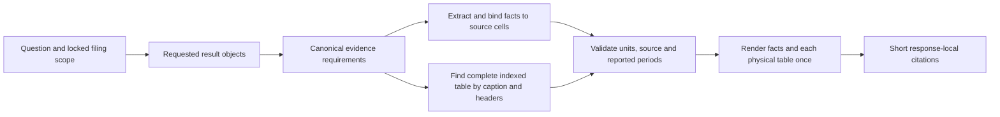

# Financial facts and complete-table repair

## What failed

Failures occurred at several stages, rather than in the underlying financial values alone. The running server also predated some source changes, so requests continued to use an older implementation until it was restarted.

| Stage | Problem | Shared replacement |
|---|---|---|
| Scope | A phrase such as “2024 annual 10-K” could lose its document-year binding and make a comparative 2023 value appear to require a missing 2023 filing. | The existing document-year parser accepts annual/quarterly descriptors while retaining separate source and reported periods. |
| Planning | Scalar requests gained unrequested commentary; one table was split into separate row, description or period requests. Those invented requirements could make final validation fail. | The existing planning call inventories requested result objects from exact original request phrases. Evidence requirements reference those objects; table parts share one object and canonical requirement. |
| Table identity | A Markdown separator could replace the statement caption. Body rows mentioning cash-flow hedges could then make a derivative note look like the primary cash-flow statement. | Empty separator captions are discarded. Table identity uses the actual caption and column headers; body-row keywords cannot supply a missing table subject. |
| Units | A “Diluted” row below an earnings-per-share section could inherit the monetary table's million scale. | Source binding uses the enclosing section, row and headers to preserve per-share type and remove amount scale. Monetary recovery does not overwrite those cells. |
| Period validation | A definition table was required to have a filing-year column even though it had no period columns. | A whole-table request does not infer a period column from the filing year. Explicit reported-period checks may also use a dated source caption. |
| Rendering | The same physical table could be printed once for each requested period. Tables with no marked headers promoted the first data row into a header. | Each requirement is validated before identical source/table output is deduplicated. Headerless tables receive neutral generated column labels and retain every original row as data. |

The inventory is part of the existing planner call; it adds no separate LLM invocation. It distinguishes the result the user requested from the evidence needed to produce it. Calculation inputs retain their own metrics and periods. Existing source, quantity, period, calculator and citation validation remains active.

No runtime question IDs, company/year-specific answer branches, gold values or new private query handlers were introduced. The ten fixed test questions and expected values appear only in verification artifacts.

## Verification

The full offline suite passed **459 tests and 66 subtests** on 2026-10-13. The 35 warnings concern existing dependency deprecations. Regression coverage includes source-year descriptors, source-bound per-share values, whole-table planning, duplicate physical tables, caption identity, dated tables without year columns, and tables without marked headers.

Live verification uses only the ten financial-fact and exact-table questions approved by the user, against FastAPI and `phase1-v2`. Reports preserve the answer, sources, request plan, tool trace, validation, latency and provider usage. A final run checks all ten at one code snapshot; earlier runs remain separate.

### Final live results

| Check | Verified output |
|---|---|
| Microsoft FY2025 revenue | 281,724 million USD |
| Tesla FY2025 gross profit | 17,094 million USD, without unrequested segment discussion |
| Tesla comparative FY2023 operating cash flow | 13,256 million USD, sourced from its 2024 filing |
| Microsoft FY2025 net income and diluted EPS | 101,832 million USD; 13.64 USD per share |
| Microsoft 2024 balance sheet | One table; 42 rendered rows; 2024/2023 columns |
| Tesla 2025 statement of operations | One table; 39 rows; 2025/2024/2023 columns |
| Microsoft 2025 primary cash-flow statement | One table; 42 rows; operating, investing, financing and cash reconciliation retained |
| Microsoft 2025 geographic revenue | One table; five source rows and all three reported years |
| Tesla 2025 cash-paid income-tax breakdown | One table; eight source data rows, including federal/state/foreign detail |
| Microsoft More Personal Computing metric definitions | One table; all three metric names and explanatory text retained as data |

All **10/10** were answered and passed the recorded validation and table-count checks. All **473 extracted source cells** across the six selected tables were found in their answers. Citation labels resolve to returned sources. The balance-sheet source has a PDF extraction continuation row; the established renderer joins its last value to the preceding row, preserving the cell content rather than printing an empty continuation row.

| Measurement for the same ten questions | Initial live run | Final live run |
|---|---:|---:|
| Answered | 6/10 | 10/10 |
| Total LLM tokens | 205,232 | 153,750 |
| Estimated LLM cost | $0.0272862 | $0.02008425 |
| Mean HTTP latency | 11.29 s | 10.16 s |

These runs show about **25.1% fewer LLM tokens** and **26.4% lower estimated LLM cost** for this set. They are sequential measurements, not a controlled latency benchmark; provider caching and quota behavior differed. A Cohere 429 triggered the existing dense/BM25/RRF fallback during testing. The total estimated LLM cost of the initial ten, corrective five and final ten runs was **$0.05783385**; embedding and reranking charges are not included in that figure.

Artifacts:

- `evals/results/financial_facts_tables_api_final_20261013.json`: final responses, traces, usage and review results.
- `evals/results/financial_facts_tables_api_final_20261013_answers.md`: readable question/answer record.
- `evals/results/financial_facts_tables_api_10_20261013.json`: initial ten-question run.
- `evals/results/financial_facts_tables_api_recheck_20261013.json`: corrective five-question run.

## Runtime and next steps

The local server was restarted and watches `src` and `backend` for Python changes. New questions use the current implementation. Refresh the browser and submit a new question; saved historical answers are not regenerated by a server restart.

“Complete table” refers to the selected indexed table. Its source rows, returned rows, period columns, generated-header status and truncation status are recorded. This does not establish that ingestion preserved every table in the original PDFs or every continuation across different indexed blocks.

The indexed More Personal Computing explanation already contains replacement characters around “TAC”. Exact-table rendering preserves that source text; it does not guess the lost characters. Correcting that text requires checking and repairing the ingestion source. Headerless source tables receive neutral `Column 1`, `Column 2`, etc.; those are generated display labels, not claimed original headers.

This task does not run all 90 gold questions, calculate RAGAS scores, or add dashboard/export features. The next feature gate is targeted calculation/comparison and narrative coverage on the relevant index, followed by a separately authorized release evaluation.
