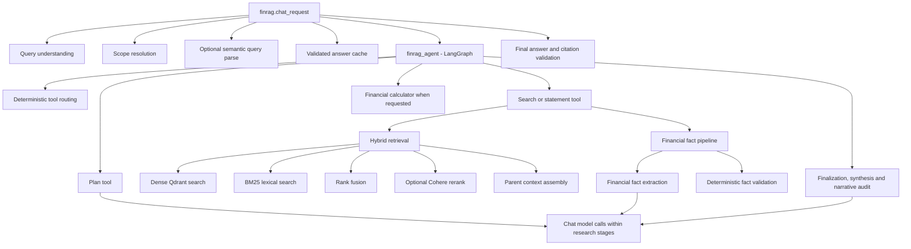

# FinRAG observability

FinRAG now sends LangChain and LangGraph runs to LangSmith when tracing is
enabled. Named FinRAG spans make the Python stages around the agent visible too.
Local request traces and API usage metrics remain available independently.

Reviewed against application source `35b8584` on 6 November 2026. The graph routes
tools deterministically; a graph span is not evidence of a paid chat-model call.
See [CURRENT_STATE.md](../CURRENT_STATE.md) for the implementation boundary.

## Configuration

Set these values in `finrag/.env` for local development, or as environment
secrets in the deployed service:

```dotenv
LANGSMITH_TRACING=true
LANGSMITH_API_KEY=your_langsmith_api_key
LANGSMITH_PROJECT=FinRAG-development
```

`LANGSMITH_ENDPOINT` is optional. Set it only for a regional endpoint or a
self-hosted LangSmith installation. Do not commit `.env` or place a real key in
`.env.example`. The example file keeps tracing disabled until a key is supplied.
Your personal access token is suitable for local development; use a service key
for unattended production or CI runs.

The `/api/health` response reports whether the tracing flag is on, whether an
API key is configured, and the selected project name. These fields report local
configuration; they do not make a network call to validate the key.

## Query trace structure

A question that reaches `ChatService.ask` creates a `finrag.chat_request` root
run. The request ID, trace ID, selected index, and resolved scope are attached
to the LangGraph run as searchable metadata. The graph's own model and tool
calls are captured by LangChain/LangGraph tracing. FinRAG adds named spans for
the custom Python work:



The corresponding span names start with `finrag.`. A comparison request can
produce multiple dense and lexical search child runs, one for each locked source
group. Tool retries or evidence refinements appear as additional child runs.

## Reading one query from top to bottom

| Run | What its input means | What its output should prove |
| --- | --- | --- |
| `finrag.chat_request` | User question, UI scope, previous scope, request/thread IDs | Final decision, answer summary, resolved scope, sources, and bounded diagnostics |
| `finrag.query_understanding` | Raw user wording | Detected companies, source years, document types, topic, comparison flags, unsupported values, and query expansions |
| `finrag.scope_resolution` | Understanding plus UI/previous scope and available corpus keys | One policy decision and the exact locked source groups sent to the agent |
| `finrag.semantic_query_parse` | Ambiguous question and available scope | Structured fallback interpretation; it appears only when deterministic parsing needs help |
| `finrag_agent` | Locked scope plus the user question and bounded conversation history | The final agent message and its model/tool interaction history |
| `plan_financial_request` | Required facts and calculations proposed by the model | A validated plan or a precise plan/clarification error |
| `search_financial_documents` | One ticker, filing year, document type, and focused query | Source count, validated facts, rejected facts, context size, and retrieval diagnostics |
| `finrag.hybrid_retrieval` | Focused query, one locked scope, and context limits | Ranked candidate count, selected sources, covered groups, and context budget use |
| `finrag.retrieval.dense_search` | Query and exact Qdrant metadata scope | Dense candidates and scores |
| `finrag.retrieval.lexical_search` | Query and exact BM25 metadata scope | Lexical candidates, scores, and query-term coverage |
| `finrag.retrieval.rank_fusion` | Dense/BM25 candidates and optional expansions | Accepted children, RRF scores, parent IDs, and retrieval groups |
| `finrag.retrieval.cohere_rerank` | Bounded fused candidates | Relevance scores and group-balanced candidates; failures fall back to RRF |
| `finrag.retrieval.context_build` | Ranked children and explicit parent/character/token limits | Which parents were selected or skipped, evidence mode, final context size, and active token counter |
| `finrag.financial.fact_extract` | Requested facts and retrieved source excerpts | Candidate values copied from evidence |
| `finrag.financial.fact_validate` | Candidate facts, sources, and permitted scope | Validated facts with IDs or rejected facts with reasons |
| `finrag.financial.calculation` | Validated fact IDs and requested operation | Formula, substituted inputs, result, units, and source IDs |
| `finrag.answer_validation` | Draft answer and allowed sources | Citation validity or an exact rejection reason |

Nested names such as `agent`, `call_model`, `RunnableSequence`, `Prompt`,
`should_continue`, and `tools` come from LangGraph/LangChain. In the current graph,
the callable behind the router returns tool calls from Python state rather than
invoking a chat model. Actual model usage comes from research stages such as
planning, fact extraction, selection, synthesis, and audit. Use provider/model
spans and usage records to count paid calls, not the name `call_model` alone.
The business-level `finrag.*` spans are the primary debugging checkpoints. A
complete answer-cache hit skips the research graph; optional semantic parsing can
still occur before the cache lookup.

`finrag.retrieval.context_build` reports an `evidence_mode` for each selected
source:

- `full_parent`: the complete parent chunk fit.
- `compressed_parent`: normal extractive compression fit.
- `budget_excerpt`: the parent was too large, so complete query-relevant blocks
  were selected without slicing a table or narrative block.

Its `parent_attempts` records `selected`, `skipped_missing_parent`, or
`skipped_no_evidence_fit`, together with the effective limits and compression
status. `token_counter` states whether the exact tiktoken encoding or the
conservative UTF-8 fallback made the budget decision.

Root and agent runs also include scalar metadata such as `scope_tickers_csv`,
`scope_years_csv`, `scope_doc_types_csv`, `scope_group_count`, `comparison`,
`request_id`, `trace_id`, and `index_version`. Tags such as `ticker:MSFT`,
`year:2025`, and `doc_type:10K` provide simple filters.

The following stages have named spans:

- Query interpretation, scope resolution, and optional semantic fallback.
- Dense search, lexical search, rank fusion, optional reranking, and context
  building.
- Financial fact extraction and validation, calculation, and final answer
  citation validation.
- Source inventory, preflight, document loading/parsing, chunking, embedding
  and index writing, plus manifest creation and write.
- RAGAS evaluation runs and per-row scoring.

Custom FinRAG spans summarize long document bodies, prompts, answers, and local
file paths. LangChain's native model/tool runs may contain the actual model
messages and tool results, including the user's question and retrieved filing
text. Only enable remote tracing for data your LangSmith workspace is allowed to
store.

## Correlating a failed request

1. Open the `LANGSMITH_PROJECT` project and filter for the `finrag` tag.
2. Copy the `trace_id` from the API response (or `X-Trace-ID` header) and search
   the run metadata/input for that ID. The same ID is written to the local query
   trace.
3. Inspect the first failing or unexpectedly empty child run: scope resolution,
   dense/lexical search, reranking, fact validation, calculation, or citation
   validation.
4. Compare the result with the local record in `data/logs/query_traces.jsonl`.
   That record includes bounded retrieval and answer-validation diagnostics.

The API's `FINRAG_DEBUG_TRACES` flag controls whether sanitized diagnostics are
included in the API response and UI. It does not enable or disable LangSmith.
`/api/health` exposes the LangSmith configuration status without returning any
credential value.

## Ingestion traces

Running `python ingest_documents.py --index-version <new-version>` creates an
`finrag.ingestion.index_build` run. Its child spans show source inventory and
preflight, parser work for each source, chunk creation, and embedding/index
writing. A failed stage records its error on the run; successful indexing still
performs the existing Qdrant count check and manifest write.

## References

- [LangChain tracing setup](https://docs.langchain.com/oss/python/integrations/llms/openai)
- [LangSmith `traceable` reference](https://reference.langchain.com/python/langsmith/run_helpers/traceable)
