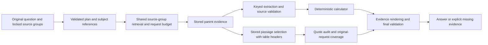

# Shared evidence-contract repair

## Recent-query reliability repair (2026-10-14)

Completed the failures reported from the recent chat: plan rejection before retrieval, retrieved evidence ending without an answer, false final-validation failures, first-attempt failures followed by successful retries, presentation tables being mistaken for source tables, and omitted arithmetic plans. The repair is contract-based and contains no question IDs, expected answers, company-specific values, or query-specific response branches.

The current source snapshot passes **467 tests and 66 subtests**, plus **18 fine-tuning dataset tests**. After restarting the local API from this snapshot, **11/11 targeted live attempts answered and validated**. This includes two independent successful runs each for the Microsoft/OpenAI narrative, Microsoft total assets, and Tesla income-tax table, plus the Tesla AI risks, Microsoft More Personal Computing, Tesla SG&A, Microsoft two-filing revenue increase, and four-input Microsoft/Tesla percentage-change requests. The live checks exercised generic search, exact-table lookup, numeric extraction, narrative quote auditing, deterministic calculation, citations, and final answer validation.

The principal corrections are: output-table intent is separated from exact source-table intent; calculation operands are normalized to facts and explicit arithmetic is deterministically completed; presentation metadata is excluded from evidence qualifiers; pure statement plans execute structured lookup even when the routing model selects generic search; every returned statement payload reaches finalization; and narrative rendering falls back to retained verified quotations while preserving business-attribution safeguards. The local API is running on `127.0.0.1:8000` with the corrected code.

A full 90-question release run and RAGAS scoring remain separate release evaluation work; they are not required to establish the reported regression fixes and were not silently combined with results from older code snapshots.

## Current financial-fact/table status (2026-10-13)

Completed the resumed repair and approved app verification: **459 offline tests and 66 subtests passed; 10/10 targeted API questions answered** at one final code snapshot. Whole-table planning, physical-table deduplication, caption/header selection, comparative-year binding, per-share units and headerless-table data preservation are covered. The local FastAPI app remains running with Python source reload. See [FINANCIAL_FACTS_TABLES_REPAIR.md](FINANCIAL_FACTS_TABLES_REPAIR.md) and `evals/results/financial_facts_tables_api_final_20261013.json`. No full-90 run or RAGAS scoring was performed in this task. Older status sections below are historical.

Next: verify targeted calculations/comparisons and narrative coverage before adding charts or table exports. Separately authorize a full release evaluation if required. One selected indexed explanation contains source replacement characters, so its original ingestion text needs review; exact-table output deliberately preserves it.

## Generic table path (2026-10-13)

Complete-table requirements and the existing lookup tool now accept arbitrary specific table titles/subjects. The three-type schema restriction and fixed statement-search templates have been removed; primary-statement names remain compatible. Shared planning preserves exact/full table intent and the renderer retains source/period/qualifier/completeness checks. Verified offline: **444 tests and 64 subtests**, including named note tables, schedules, text-only/no-year-header tables and twelve-column source layouts. No paid API run was performed. See `ANSWER_PRESENTATION.md` for behavior and limitations.

## Latest table-finalization correction (2026-10-13)

The subsequent Tesla statement-of-operations request was retrieved but summarized because its plan used `kind=narrative`. Explicit full-table intent now binds recognized statement requirements to `kind=statement`, and planning/tool validation reuse the existing statement-name matcher. The corrected local replay returned all **39 indexed rows and 2025/2024/2023 columns**. Latest offline verification: **424 tests and 64 subtests passed**; no paid API check was made. See `ANSWER_PRESENTATION.md` for the exact cause, shared replacement and replay artifact.

The recent MSFT 2024 balance-sheet failure occurred after successful table retrieval: the routing model stopped without calling the finalizer. The shared graph now requires tool calls until verification or a terminal result, while allowing clarification and validated completion to stop. Local indexed-evidence replay validated the full selected balance sheet (42 rendered rows, 2024/2023 columns, no truncation). The full offline suite passed **414 tests and 64 subtests**; no fresh paid API evaluation was run for this correction. See `ANSWER_PRESENTATION.md` for details and restart instructions.

## Problems and replacements

| Stage | Weak behavior | Current contract |
|---|---|---|
| Planning | Guessed quantity types, duplicate observations, unrequested statement tables, inconsistent business scope | Source-group-constrained plan; units come from evidence; statement intent reuses the existing parser; typed subject references distinguish businesses/assets from observations |
| Fact extraction | Free-form lists could swap, repeat or omit requirement IDs | One structured slot per numeric requirement; absent values are null; source IDs are constrained to retrieved evidence |
| Source binding | Prose paraphrases failed exact-word checks; a count could inherit currency and scale | Literal source labels and their own excerpts anchor values; actual row/year/leaf headers determine table bindings and count units |
| Narrative tables | Copied rows lost their column/year headers | Stored headers accompany selection, verification and display; exact contiguous quotations retain source provenance and preceding paragraph context |
| Narrative verification | One good quote could validate unrelated quotes; answered plan slots could conceal omitted request details | Source-bound quotations and typed source ownership; independently audited quote verdicts; explicit missing requested details after irrelevant quotes are removed; original-request coverage |
| Final presentation | Header annotation pipes looked like malformed Markdown tables; trace hid the actual failure | Safe annotation separators and the actual final-validation reason |
| Calculations | An inequality could be treated as an exact input | Preserve source bounds and reject them as exact calculator operands |

No runtime question IDs, gold answers, company-specific financial aliases, or new query-specific helpers are used by these repairs. Existing deterministic source, raw-value, row/column, period, currency, unit, calculator-input and citation checks remain active. Planning labels may be paraphrased; copied source evidence must retain provenance.

## Runtime flow

The 12,000-token budget bounds packed evidence, not total API input across planning, extraction, routing, selection and verification. Full source bodies stay out of repeated routing-model history. Recovery is bounded; it does not permit unsupported facts or unlimited retrieval.

## Verification status

The earlier evidence-contract check passed **185 tests and 22 subtests**. This includes planning, evidence contracts, source bindings, table lookup, tool schemas, calculator behavior and ChatService. Existing LangGraph deprecation warnings remain.

The approved 30-question run `langgraph_targeted_30_resumed_final.json` recorded **21/30 answered** at an earlier code snapshot. A subsequent check of its nine failures recorded **7/9 answered** in `langgraph_remaining_nine_verified.json`. These different code snapshots cannot be combined into a current 90-question score.

The running FastAPI server holds the local Qdrant index lock. It was left running. Subsequent Q090 checks therefore replay saved retrieved evidence through the changed selection/verification stages; they do not test fresh retrieval or the complete graph. The latest such report is `evals/results/q090_final_shared_contract_replay.json`. Manual review of this final replay found the requested energy-storage backlog, MegaPack 3 / Mega Block, increasing deployments and margin pressure, with unrelated automotive backlog removed. This is a saved-evidence stage check after focused recovery, not a fresh end-to-end evaluation.

Generation `passed` measures decision expectations and runtime checks. It is not RAGAS scoring or independent proof of factual accuracy. No fresh full-90 run or RAGAS scoring is part of this repair.

## Evidence packing

Passages are grouped by source rather than repeating long source IDs and JSON metadata per sentence. Auditing excludes duplicate display text and quote-only summaries. Each shared audit quote is stored once with ordered references from requirements. Business attribution uses preceding source context and source-vocabulary-constrained entity types; a measurement or status cannot serve as a business owner. Audit observations are constrained to the actual stored quotation, preventing verdicts for neighboring text from being applied to it. Exact quotations can span adjacent source sentences. A mistaken source ID is corrected only when exactly one source in the required group independently contains the exact quotation; unsupported candidates remain unavailable and preserve other valid selections.

A local replay of the same saved Q090 evidence retained all **484 sentences**, reducing passage-formatting input from **30,234 to 12,530 tokens**. This measures formatting overhead only, not total graph usage or answer quality.

## Next release checks

1. Stop the current FastAPI server temporarily before an evaluator run; local Qdrant permits one client at a time. Restart the server to load source changes.
2. Rerun only the last failed IDs: 5, 7, 13, 54, 57, 63, 73, 76 and 90. Review business scope, units, reported periods and requested details.
3. A fresh 90-question release evaluation and separate RAGAS scoring remain future checks; neither was performed against the final code in this repair.
4. Verify index-specific company coverage. This gold set does not establish JPM performance.

Authentication and formula-catalog integration remain excluded as requested. Existing monetary table recovery assumes USD for this corpus; another currency corpus needs its own source-unit verification. Provider quota and cache behavior affect observed latency and cost.

## Presentation update

The shared presentation layer now produces independently verified thematic points, grouped company/period sections, readable numeric values and response-local citation labels with matching source links. Source Markdown is escaped rather than interpreted as answer structure. See `ANSWER_PRESENTATION.md` for the changes and verification. The latest full offline suite passed **407 tests and 64 subtests** on 2026-10-13; the earlier focused suite passed **226 tests and 22 subtests**. Comparisons now use evidence-derived tables; calculations include their deterministic formula traces. Browser rendering handles nested styling and Markdown wrappers, and history retains all cited sources. No fresh paid model/corpus evaluation was performed for this presentation update. Restart FastAPI and hard-refresh the browser before checking a new answer.
