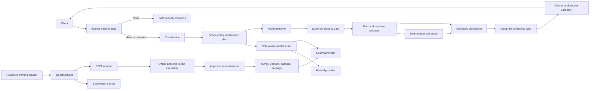

# FinRAG Version 2 Technical Design Document

| Field | Value |
| --- | --- |
| Status | Proposed target architecture; some supporting training/tracking tools already exist |
| Document version | 1.1 |
| Original design date | 2026-10-14 |
| Implementation status reviewed | 2026-11-06, application source `35b8584` |
| Target release | FinRAG Version 2 |
| Baseline | Current `phase1-v2` application and indexes |
| Primary tracking decision | MLflow, with an optional W&B implementation behind the same interface |
| Model-serving target | Local Ollama service |

## Reading this proposal against the current code

The milestones, configuration examples, interfaces, and security architecture in
this document describe intended Version 2 behavior. They are not evidence that
the entire design is deployed. Use [CURRENT_STATE.md](../CURRENT_STATE.md) and
the implementation to establish what actually exists.

| Capability | Implemented today | Still proposed or requiring verification |
| --- | --- | --- |
| Dataset/training | Dataset factory, split/export checks, separate QLoRA trainer/notebook, reviewed historical reports and backed-up adapter | Active finalization-schema compatibility and promotion gates for each model role |
| Experiment tracking | Separate MLflow import of historical training/quality/serving summaries, with partial-lineage tags | Live training hooks, complete new-run lineage, and optional W&B adapter |
| Chat providers | Compatible endpoint/key configuration and a separate evidence-model setting | Typed role-aware provider/capability selection and local-only policy enforcement |
| Model serving | Configurable chat endpoint and serving benchmark tools | Integrated Ollama packaging, lifecycle, readiness, and deployment validation |
| Security | Existing scope/tool restrictions, strict API contracts, safe public errors, deadlines, and cooperative cancellation | The layered PII and prompt-injection policy/redaction system described below |

## 1. Purpose

This document defines the design for adding a fine-tuned answer-generation model,
Ollama serving, fine-tuning experiment tracking, personally identifiable
information (PII) controls, and prompt-injection defenses to FinRAG.

It is a design and acceptance contract. It does not claim that these Version 2
features are already implemented. Phase 1 must remain usable while Version 2 is
built and evaluated incrementally.

In this document, **PII** is assumed to be the intended meaning of “P2.” If “P2”
refers to a different control, that requirement needs a separate design decision.

## 2. Executive summary

FinRAG already has a working evidence-grounded pipeline: scope resolution, hybrid
retrieval, structured table lookup, financial fact validation, deterministic
calculations, narrative evidence auditing, citations, FastAPI/Streamlit clients,
and request tracing. The original design baseline recorded 467 tests and 66
subtests, plus 18 fine-tuning dataset tests. The latest recorded offline
verification is listed separately in [CURRENT_STATE.md](../CURRENT_STATE.md);
those checks do not establish completion of this proposal.

The Version 2 target covers four capabilities without weakening those controls;
the status table above distinguishes existing supporting work from the remaining
integration and release work:

1. Train a LoRA/QLoRA adapter from reviewed, leakage-safe FinRAG examples.
2. Package an approved model for local inference through Ollama.
3. Record every training and evaluation run in MLflow by default.
4. Enforce layered PII and prompt-injection controls before logging, retrieval,
   model invocation, tool execution, and response delivery.

The fine-tuned model will initially be used only in generation roles for which it
has been trained and evaluated. Planning, tool routing, fact extraction, and
independent answer auditing will not be moved to the local model merely because it
can produce fluent text. Each model role must pass its own structured-output and
security gates before migration.

## 3. Goals and non-goals

### 3.1 Goals

- Produce reproducible adapters with traceable data, configuration, code, hardware,
  metrics, and artifacts.
- Compare the same base model with and without the adapter while keeping retrieval
  and evaluation inputs fixed.
- Serve an approved local model through Ollama without coupling business logic to a
  single provider.
- Preserve current evidence, calculation, citation, scope, and abstention
  guardrails for both hosted and local models.
- Prevent raw sensitive user data from entering ordinary logs or remote tracking.
- Detect direct and indirect prompt-injection attempts and enforce deterministic
  boundaries even when detection is uncertain.
- Support controlled rollout, immediate provider rollback, and artifact lineage.

### 3.2 Non-goals for Version 2

- Fine-tuning the embedding model or reranker.
- Training on the locked evaluation benchmark or its paraphrases.
- Removing deterministic financial validation in favor of model confidence.
- Allowing the model to execute arbitrary code, shell commands, URLs, or tools.
- Automatically falling back from local inference to a cloud model when local-only
  privacy mode is selected.
- Public, multi-tenant deployment. If the service is exposed beyond localhost,
  authentication, TLS, authorization, and deployment-level rate limiting become
  release requirements.

## 4. Current-state baseline

### 4.1 Runtime

- FastAPI and Streamlit call the same `ChatService` pipeline.
- Query understanding resolves company, filing year, document type, comparison
  groups, and table intent.
- Qdrant dense retrieval and a local BM25-style index are combined with reciprocal
  rank fusion. Cohere reranking is optional.
- Parent document evidence is packed within character and token budgets.
- The LangGraph agent can plan, retrieve, look up complete statements, calculate,
  and finalize an answer.
- Facts are accepted only after source, period, row/column, unit, scale, and request
  binding checks.
- Narrative evidence is selected from stored quotations and independently audited.
- Final answers use validated facts, calculator output, verified quotations, and
  retrieved source IDs.
- The current `get_llm_engine()` factory supports OpenAI-compatible chat endpoints
  for planning, extraction, selection, synthesis, and audit. Evidence stages can
  select `FINRAG_EVIDENCE_MODEL`. Graph tool routing is deterministic and does not
  call a model. A complete role-aware provider interface remains proposed.

### 4.2 Fine-tuning

The repository already separates dataset construction from training:

- Candidate generation, deterministic validation, human review, benchmark leakage
  protection, group-level splitting, and SFT export are implemented.
- QLoRA training uses Transformers, TRL, PEFT, bitsandbytes, and a separate training
  environment.
- The trainer refuses to overwrite a non-empty output directory and produces a
  basic training manifest.
- Training reporting is currently disabled with `report_to="none"`.
- `fine_tuning/tracking/` separately imports reviewed historical summaries into
  MLflow. It neither instruments the trainer nor upgrades historical lineage to
  complete provenance.
- The example base model is a candidate, not an approved production decision.

### 4.3 Contract mismatch to resolve before runtime promotion

The existing SFT export describes a grounded response using `answer`, `claims`, and
`source_ids`. The active runtime now finalizes through `RequirementAnswer`,
`EvidenceSynthesis`, narrative audit, and deterministic rendering. The legacy
`AnswerGenerator` is not the active LangGraph finalization path.

Before promoting an adapter into the active Version 2 runtime, an architecture
test must prove that the training completion schema is consumed by the active
runtime. The chosen solution must be one of:

1. Export completions matching the active requirement-selection/synthesis schema;
   or
2. Add a small, typed compatibility boundary that converts a stable generation
   schema into the active runtime objects and validates it before rendering.

Training an adapter for an unused or incompatible response schema is prohibited.

## 5. Architecture decisions

| ID | Decision | Reason |
| --- | --- | --- |
| ADR-01 | Keep retrieval, validation, calculation, and citation enforcement model-independent. | A local model must not bypass deterministic safety. |
| ADR-02 | Add role-aware model-provider interfaces instead of replacing `get_llm_engine()` with Ollama-specific calls. | Different roles require different capabilities and can migrate independently. |
| ADR-03 | Use MLflow as the default experiment tracker. | It supports local/self-hosted operation and reduces unnecessary transfer of financial training metadata. |
| ADR-04 | Permit W&B only as an alternative implementation selected by configuration. | Avoid duplicate runs, artifacts, and inconsistent lineage. |
| ADR-05 | Retain the PEFT adapter for lineage, but deploy a merged and validated model as the default Ollama artifact. | Direct adapter compatibility depends on the exact base architecture and Ollama version. |
| ADR-06 | Do not silently fall back to a remote model in local-only mode. | A hidden fallback would violate privacy and make evaluations irreproducible. |
| ADR-07 | Apply PII controls before model calls and before all persistent/remote logging. | Redaction after logging is too late. |
| ADR-08 | Treat retrieved text as untrusted data, never as executable instructions. | Filing or transcript text can contain instruction-like content or later indexes may include malicious documents. |
| ADR-09 | Prompt-injection detection informs policy but is not the security boundary. | Classifiers and patterns can miss attacks; tool and scope enforcement must remain deterministic. |
| ADR-10 | Promote models only through baseline-relative end-to-end evaluation. | Lower training loss alone does not demonstrate safer or better FinRAG answers. |

## 6. Target architecture



## 7. Model-provider design

### 7.1 Role-aware interface

The provider boundary must identify the task, not only the model name. Proposed
roles are:

- `agent_router`
- `request_planner`
- `fact_extractor`
- `semantic_query_parser`
- `evidence_selector`
- `evidence_synthesis`
- `evidence_auditor`
- `answer_repair`
- `dataset_teacher`
- `dataset_reviewer`

`agent_router` is a possible future role only. The current graph router is Python
policy and makes no model call; this proposal does not establish a deployed
model-routing stage.

The factory should conceptually expose:

```python
get_llm_engine(role=ModelRole.EVIDENCE_SYNTHESIS, capabilities={"json_schema"})
```

Every provider implementation must declare and test capabilities such as:

- JSON-schema structured output
- deterministic temperature configuration
- tool calling and required tool choice
- parallel tool calls
- context-window limit
- cancellation and timeout behavior
- token/latency usage reporting

Configuration must map roles to providers and model releases. A provider cannot be
selected for a role when a required capability is absent.

### 7.2 Initial rollout boundary

The first local release will target `evidence_selector` and/or
`evidence_synthesis`, depending on the final training-schema decision. The local
model must not initially control:

- scope resolution;
- request-plan acceptance;
- tool selection;
- numeric extraction validation;
- independent evidence auditing; or
- final citation validation.

Those roles can move later only after separate tool-calling, schema-conformance,
financial-accuracy, and adversarial evaluations.

### 7.3 Configuration

Planned variables are names, not implemented settings:

```dotenv
FINRAG_LLM_PROVIDER=openai
FINRAG_GENERATION_PROVIDER=ollama
FINRAG_AUDIT_PROVIDER=openai
FINRAG_OLLAMA_BASE_URL=http://127.0.0.1:11434
FINRAG_OLLAMA_MODEL=finrag-answer:<release>
FINRAG_OLLAMA_TIMEOUT_SECONDS=120
FINRAG_LOCAL_ONLY=false
FINRAG_PROVIDER_FALLBACK=disabled
```

Secrets must never appear in a model release manifest, Modelfile, API trace, or
tracked training configuration.

## 8. Fine-tuning and experiment tracking

### 8.1 Tracker interface

Training code will depend on an internal `ExperimentTracker`, not directly on
MLflow or W&B throughout the trainer. Required operations are:

- start/end run;
- log parameters and tags;
- log scalar metrics by step and epoch;
- log a bounded artifact or artifact reference;
- record failure state;
- return the external run ID and URI.

Supported configuration:

```dotenv
FINRAG_TRAINING_TRACKER=mlflow
MLFLOW_TRACKING_URI=<local-or-self-hosted-uri>
MLFLOW_EXPERIMENT_NAME=finrag-qlora
# Alternative, never active simultaneously:
# FINRAG_TRAINING_TRACKER=wandb
# WANDB_PROJECT=finrag-qlora
```

MLflow is the default. W&B is an explicit alternative; one training process must
not report the same run to both systems.

### 8.2 Required run lineage

Every run must record:

- run ID, parent/sweep ID, start/end time, and final status;
- Git commit, dirty-worktree flag, training script version, and dependency lock
  hash;
- base model repository, immutable revision, tokenizer revision, license, and chat
  template hash;
- dataset manifest path, SHA-256 hashes, split counts, policy version, review
  summary, and benchmark-overlap result;
- complete non-secret QLoRA configuration;
- seed, CUDA/PyTorch versions, GPU type/count, compute dtype, and world size;
- training/evaluation loss, learning rate, epoch, throughput, peak memory when
  available, and selected checkpoint;
- adapter configuration and SHA-256 hashes;
- offline and end-to-end evaluation results;
- failure type and last completed stage for failed runs.

Raw training rows, user questions, retrieved evidence, credentials, and detected
PII must not be copied into tracking tags or metrics. Dataset artifacts are stored
only when their approved storage policy allows it; otherwise the tracker receives
hashes and manifests.

### 8.3 Training comparison

Every candidate adapter must be evaluated against:

1. The exact same base model without the adapter.
2. The current production pipeline baseline.
3. Prior approved adapter releases, if any.

The base-versus-adapter comparison must use identical retrieval results, prompts,
generation limits, quantization where applicable, and evaluation examples. Hosted
OpenAI-versus-local comparisons may be reported separately but cannot be described
as the adapter's causal improvement.

## 9. Model artifact and Ollama lifecycle

### 9.1 Artifact stages

```text
reviewed dataset
  -> QLoRA run
  -> PEFT adapter + tokenizer + training manifest
  -> adapter evaluation
  -> merge with the exact pinned base revision
  -> merged-model validation
  -> GGUF conversion
  -> quantization candidates
  -> Ollama Modelfile and model creation
  -> Ollama conformance/evaluation
  -> approved release alias
```

The unmerged adapter is the scientific training artifact. The merged/quantized
model is the default deployment artifact. Direct Ollama `ADAPTER` packaging may be
evaluated only when the pinned Ollama version explicitly supports the adapter's
architecture and the exact same base model is used.

### 9.2 Model release manifest

Each deployable release needs a machine-readable manifest containing:

- release name and semantic version;
- training tracker run ID/URI;
- base model ID, revision, license, and hashes;
- adapter hashes and PEFT configuration;
- merge/conversion tool versions and commands;
- GGUF hash and quantization type;
- Modelfile hash and Ollama version;
- context window and generation parameters;
- evaluation dataset/version and metric summary;
- approval identity/date and rollback predecessor.

### 9.3 Ollama packaging rules

- Bind Ollama to localhost unless an approved protected network design exists.
- Use an immutable versioned model name; a friendly alias may point to the approved
  release.
- Set deterministic generation defaults suitable for grounded financial answers.
- Configure a context window large enough for the packed evidence plus system,
  tool/schema, history, and output reserves. The current 12,000-token evidence
  budget is not the complete prompt size.
- Benchmark concurrency against actual CPU/GPU memory. The current API concurrency
  setting must not be assumed safe for a local 7B model.
- Fail readiness when the configured model is absent or cannot complete a schema
  conformance probe.
- Never download or replace a production model implicitly during a user request.

Ollama supports creating models from Safetensors directories or GGUF files, while
adapter support depends on matching base models and supported architectures. The
production packaging pipeline therefore includes an explicit compatibility test
and merged-model fallback.

## 10. Security design

### 10.1 Threat model

Version 2 must address:

- users submitting contact details, account identifiers, credentials, or other PII;
- sensitive text entering local JSONL, LangSmith, MLflow, W&B, exception, or access
  logs;
- direct prompts asking the model to ignore policy, reveal prompts/secrets, broaden
  scope, fabricate citations, or invoke unauthorized tools;
- indirect instructions embedded in indexed documents;
- poisoned fine-tuning examples that teach policy bypasses;
- output leakage of PII, secrets, system prompts, or uncited content;
- model artifacts built from the wrong base revision or unapproved data;
- silent cloud fallback from a supposedly local request.

### 10.2 Security assessment contract

All security detectors return data, not free-form prose:

```text
SecurityAssessment
  decision: allow | redact | block | review
  pii_categories: bounded category list
  injection_categories: bounded category list
  redacted_text: optional transient value
  detector_versions: map
  policy_version: string
  reason_codes: bounded list
```

Persistent traces record category counts, decision, policy version, and detector
versions. They do not store the original sensitive span.

### 10.3 PII controls

PII enforcement occurs at four boundaries:

1. **User ingress:** detect secrets, credentials, government/account identifiers,
   email addresses, phone numbers, addresses, and configured personal identifiers.
2. **Logging and tracking:** sanitize before `_record`, remote tracing, experiment
   tracking, exception reporting, or analytics.
3. **Training data:** scan candidates before review/export and again before training.
4. **Output:** block or redact sensitive content that is neither necessary nor
   explicitly supported by an allowed public source.

Public SEC filing content must not be blindly rewritten because exact evidence and
citations depend on source fidelity. Instead, source documents are assigned a
provenance/trust class. Public corporate names and public filing facts are not
treated the same as private user-provided identifiers.

The detector implementation should combine deterministic patterns/checksums with a
replaceable named-entity detector. Policy, thresholds, entity allowlists, and
redaction tokens are versioned independently from detector code.

### 10.4 Prompt-injection defenses

Detection covers direct and indirect injection, but enforcement is layered:

- System/developer policy is constructed outside user and evidence text.
- User text and retrieved evidence are passed in explicit structured fields.
- Evidence is labeled as untrusted data and cannot define tools or change policy.
- Scope is resolved before retrieval and tool arguments are validated against the
  locked scope.
- Only registered financial tools are callable; no generic HTTP, shell, file-write,
  or code-execution tool is exposed to the model.
- Tool action budgets, token budgets, timeouts, and cancellation remain enforced.
- Source IDs, facts, calculations, and statement IDs must originate from validated
  runtime state.
- A model request to broaden scope, expose secrets, invent source IDs, or bypass
  validation is rejected regardless of the detector score.
- Output validation checks citations, numeric grounding, prohibited disclosure, and
  PII before delivery.

Instruction-like text in retrieved evidence is preserved for citation fidelity but
is never promoted to the instruction channel. High-risk evidence can be quarantined
or require review; silently deleting arbitrary source text is avoided.

### 10.5 Logging and tracing changes

The current local trace includes a bounded copy of the question, and native remote
model traces may include prompts and retrieved evidence. Version 2 must introduce a
single sanitizer used before every persistent or remote sink.

Required behavior:

- raw sensitive values remain transient in memory only;
- safe request/trace IDs correlate sanitized events;
- provider/model release, security decision, latency, token usage, retrieval
  coverage, validation results, and reason codes remain observable;
- full prompt/evidence logging is off by default;
- remote tracing is disabled automatically when policy requires local-only handling;
- log retention and deletion are configurable and documented.

## 11. Request lifecycle

1. FastAPI validates request schema, length, encoding, and rate limits.
2. The ingress security gate scans the question and bounded conversation history.
3. Blocked requests receive a stable safe response and no model/tool call.
4. Redacted requests continue with a transient sanitized representation.
5. Scope policy locks company, filing year, and document type.
6. The role-aware provider performs planning/routing with only allowed capabilities.
7. Retrieval obtains evidence within locked scope and budgets.
8. The evidence gate identifies instruction-like or prohibited content without
   turning it into system instructions.
9. Existing fact, statement, calculation, narrative, and citation validation runs.
10. The configured generation provider produces only the typed generation object.
11. An independently configured auditor verifies narrative evidence.
12. Output DLP/PII and prompt-leak checks run before the response leaves the service.
13. Sanitized metrics and reason codes are logged.

## 12. API and compatibility

Existing `/api/chat`, `/api/chat/stream`, `/api/health`, and `/api/catalogue`
contracts remain available. Proposed additive changes are:

- `security_blocked` as a new `Decision` value;
- sanitized provider/model-release information in debug traces;
- security decision and reason codes in debug traces, never matched text;
- health fields for provider readiness, configured release, security policy version,
  and tracking availability;
- SSE stage events for security screening and local-model inference.

Clients must handle unknown/additional decision values safely before the new value
is enabled. Ordinary responses must not reveal detector rules, system prompts, or
raw rejected text.

## 13. Proposed code organization

These paths are a design proposal and should be created only during implementation:

```text
src/
|-- llm/
|   |-- roles.py
|   |-- factory.py
|   `-- providers/
|       |-- openai_provider.py
|       `-- ollama_provider.py
|-- security/
|   |-- models.py
|   |-- policy.py
|   |-- pii.py
|   |-- prompt_injection.py
|   `-- sanitization.py
fine_tuning/
|-- tracking/
|   |-- base.py
|   |-- mlflow_tracker.py
|   `-- wandb_tracker.py
|-- deployment/
|   |-- merge_adapter.py
|   |-- convert_gguf.py
|   |-- build_ollama.py
|   `-- release_manifest.py
deploy/ollama/
|-- Modelfile.template
`-- README.md
evals/v2/
|-- model_conformance_cases.json
|-- prompt_injection_cases.json
`-- pii_cases.json
```

Training-only tracking, conversion, and GPU dependencies must stay out of the core
runtime requirements unless runtime use is proven necessary.

## 14. Evaluation and acceptance gates

### 14.1 Test layers

- **Unit:** provider capability checks, tracker behavior, manifest hashing, PII
  policy, injection classifications, sanitization, and security decisions.
- **Contract:** active training schema round-trips through the production
  finalization boundary.
- **Integration:** mocked Ollama/MLflow/W&B failures, timeouts, cancellation, missing
  models, malformed JSON, and unavailable trackers.
- **Model conformance:** typed output, context length, deterministic parameters,
  stop handling, and refusal behavior.
- **Financial regression:** current fact, table, narrative, calculation, coverage,
  and citation suites.
- **Adversarial security:** direct/indirect injection, tool coercion, scope override,
  prompt extraction, data exfiltration, encoded attacks, and PII canaries.
- **End-to-end:** locked evaluation questions on base, adapter, merged model, and
  quantized Ollama release.
- **Load:** latency, queueing, memory, cancellation, and concurrent request behavior
  on declared target hardware.

### 14.2 Release gates

| Area | Required result |
| --- | --- |
| Data | Policy passes; human review recorded; zero benchmark overlap |
| Reproducibility | Run can be reconstructed from manifests, hashes, code revision, and pinned base revision |
| Schema | 100% valid typed output on the locked conformance set |
| Citations | Zero invented source IDs; existing citation validation remains green |
| Numeric safety | Zero accepted source/value/unit/period mismatches in the locked financial set |
| Coverage | No regression in required company/year/document-group coverage |
| Quality | Adapter beats or meets the identical unadapted base on approved primary metrics |
| Abstention | Unsupported questions continue to abstain instead of fabricating |
| Prompt injection | No adversarial case can unlock a disallowed tool, alter locked scope, expose secrets, or bypass final validation |
| PII | All seeded high-risk canaries are blocked/redacted; clean-corpus false-positive rate meets the approved policy target |
| Privacy | Local-only mode produces no remote model, tracing, tracking, or fallback calls |
| Operations | Model readiness, timeout, cancellation, rollback, and missing-model behavior pass |
| Performance | Declared target hardware meets the approved p50/p95 latency and concurrency budget |

Thresholds for subjective answer-quality metrics and clean-input PII false positives
must be approved before evaluation; they must not be selected after seeing candidate
model results.

## 15. Rollout plan

### Milestone 0 — Design approval

- Approve this TDD.
- Confirm that “P2” means PII.
- Select target hardware and local/privacy requirements.
- Record remaining choices as architecture decision records.

### Milestone 1 — Tracking and reproducibility

- Implement the tracker interface and MLflow backend.
- Add W&B only if it is actually required.
- Expand the training manifest and add failure logging.
- Test that secrets and raw examples never reach the tracker.

### Milestone 2 — Training-contract alignment

- Choose the active generation schema.
- Update dataset export or add the typed compatibility boundary.
- Add a production round-trip contract test.
- Rebuild/review the dataset if the target schema changes materially.

### Milestone 3 — Adapter training and evaluation

- Pin base model/revision/license and hardware configuration.
- Run unadapted-base baseline.
- Train candidate adapters with tracked configurations.
- Select by locked validation/evaluation results, not training loss alone.

### Milestone 4 — Ollama packaging

- Merge the selected adapter into the exact base revision.
- Convert and evaluate quantization candidates.
- Build the versioned Ollama model and release manifest.
- Run conformance, financial, latency, and memory tests.

### Milestone 5 — Provider integration

- Add the role-aware provider interface.
- Integrate Ollama only for approved generation roles.
- Run shadow comparisons without returning local output to users.
- Preserve an explicit configuration rollback to the prior provider.

### Milestone 6 — Security observe mode

- Add ingress, evidence, output, training-data, and logging security gates.
- Record only sanitized categories and decisions.
- Measure false positives/negatives without blocking normal traffic.

### Milestone 7 — Enforcement and release

- Approve policy thresholds.
- Enable blocking/redaction.
- Run the complete offline, adversarial, and live release evaluations.
- Canary the Version 2 release and monitor validation failures, latency, security
  decisions, and resource use.

## 16. Rollback

- Provider selection is configuration-driven and versioned.
- The previous approved model name and manifest remain available.
- A local-only request never rolls back to a cloud provider automatically.
- Rollback triggers include readiness failure, schema failures, increased financial
  validation failures, citation regressions, security bypass, PII leakage, resource
  exhaustion, or latency-budget breach.
- Model rollback does not roll back the deterministic evidence, scope, calculation,
  citation, or security controls.

## 17. Risks and mitigations

| Risk | Mitigation |
| --- | --- |
| Adapter is trained for an inactive schema | Require the production round-trip contract before training |
| Ollama cannot apply the adapter architecture directly | Deploy a merged model; retain adapter separately for lineage |
| Quantization degrades structured output or arithmetic context | Evaluate every quantized artifact; promote only passing builds |
| Local model lacks reliable tool calling | Keep control-plane roles on a proven provider until their own gates pass |
| Training-data leakage inflates metrics | Preserve locked benchmark and group-level split checks |
| Tracking service receives sensitive data | Log hashes/manifests and sanitized metrics, not raw examples or prompts |
| PII detection corrupts public filing evidence | Distinguish private ingress from provenance-approved public sources |
| Injection detector misses an attack | Enforce scope, tool, source, budget, and output rules independently |
| Security detector blocks valid finance questions | Observe mode, category-specific thresholds, allowlists, and measured false-positive gates |
| Ollama exhaustion under concurrent traffic | Provider-specific semaphore, bounded queue, load test, and readiness monitoring |
| Hidden provider fallback breaks privacy | Default fallback disabled and test network egress in local-only mode |

## 18. Open decisions before implementation

1. Confirm that the requested “P2 detection” is PII detection.
2. Select target hardware, operating system, VRAM/RAM, latency, and concurrency
   budgets.
3. Approve the base model and immutable revision after license, context-window,
   Ollama-conversion, and quality checks. The current Qwen example is not approval.
4. Choose the active fine-tuned output schema and close the runtime/training contract
   mismatch.
5. Choose local-only MLflow or a shared self-hosted tracking deployment.
6. Decide whether W&B is required; otherwise do not implement it in Version 2.
7. Approve PII categories, redaction/block policy, retention, and false-positive
   threshold.
8. Define the declared deployment boundary: localhost only or protected network.
9. Freeze Version 2 evaluation datasets and metric thresholds before training.

## 19. Definition of done

Version 2 is complete only when:

- every training run is reproducibly tracked;
- the active runtime consumes the trained schema;
- the approved adapter, merged model, GGUF, Ollama model, and release manifest have
  complete lineage;
- local serving passes the financial and structured-output regression suites;
- PII and prompt-injection controls pass adversarial tests;
- local-only mode has no unintended network egress;
- current evidence, calculation, citation, and abstention tests remain green;
- rollout and rollback are demonstrated; and
- the documentation describes the actual implemented system rather than the
  proposed design.

## 20. Primary implementation references

- [Ollama API: create a model from Safetensors or GGUF](https://github.com/ollama/ollama/blob/main/docs/api.md#create-a-model)
- [Ollama model import and adapter guidance](https://github.com/ollama/ollama/blob/main/docs/import.md)
- [MLflow experiment tracking](https://mlflow.org/docs/latest/ml/tracking/)
- [MLflow Transformers and PEFT integration](https://mlflow.org/docs/latest/ml/deep-learning/transformers/)
- [Hugging Face Transformers integration with W&B](https://github.com/huggingface/transformers/blob/main/examples/pytorch/README.md#weights--biases)

